<h1 align="center">🪟 win-customization</h1>

<p align="center">
  <a href="README.md"></a>
  <a href="README.en.md"></a>
  <a href="README.zh.md"></a>
</p>

<p align="center">
  Windows 10 in a "liquid glass" style: centered transparent taskbar, blurred windows,<br>
  glass File Explorer, acrylic terminal with a Windows 7 splash. Everything is reproducible with scripts.
</p>

<p align="center">
  
  
  
  
  <a href="https://github.com/swensi17/win-customization/stargazers"></a>
  
  <a href="https://github.com/swensi17/win-customization/releases"></a>
</p>

<p align="center">
  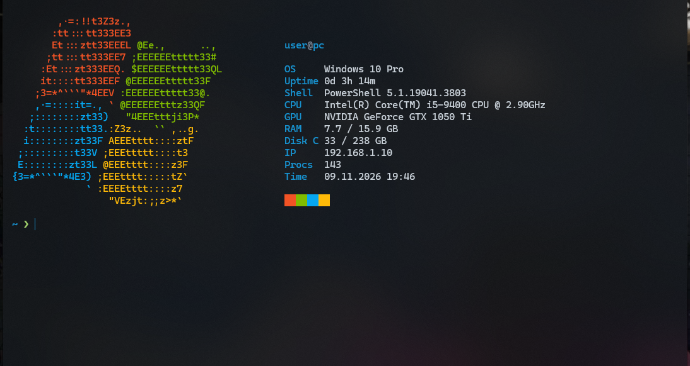
</p>

<p align="center">
  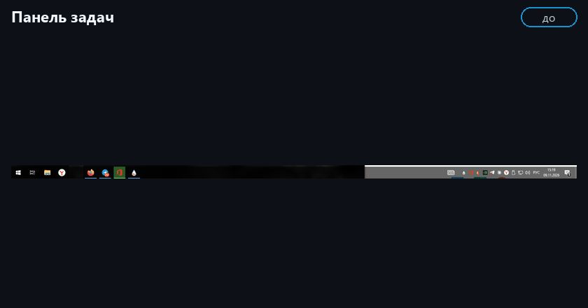<br>
  <sub>Before → after, scene by scene (the frames loop)</sub>
</p>

---

## 📑 Contents

- [✨ Overview](#-overview)
- [🧱 Build and compatibility](#-build-and-compatibility)
- [🖼 Before and after](#-before-and-after)
- [🧩 Components](#-components)
- [🚀 Quick start](#-quick-start)
- [🧪 Verifying the setup](#-verifying-the-setup)
- [❓ Troubleshooting](#-troubleshooting)
- [🗂 Repository layout](#-repository-layout)
- [⚠️ Limitations](#️-limitations)
- [♻️ Rollback](#️-rollback)
- [💖 Support](#-support)

---

## ✨ Overview

Out of the box Windows 10 has none of the transparency and blur of Windows 11: the taskbar is left-aligned and opaque, windows are flat grey, the console looks like the nineties. This repository is a working combination of small tools and settings that brings the system closer to a modern look without replacing the OS shell.

**What you get:**

- 🧭 centered taskbar icons and a fully transparent taskbar, the News widget is off, the tray is clean;
- 🪟 dark blurred glass on the title bars and borders of every window;
- 📁 glass background inside File Explorer;
- 🖱 extra context-menu items: "End process", "Close hung programs", "Task Manager";
- 🖥 Windows Terminal as the default terminal: acrylic, a custom colour scheme, a Windows 7 splash with system info, for both PowerShell and `cmd`;
- 📊 a load indicator in the tray: one number 0–100 (RAM fill, click switches to CPU), tooltip with gigabytes;
- 🔤 a Nerd Font and a prompt with the git branch, command duration and a status-coloured arrow;
- ⬇️ a Quake terminal: `Win + ~` drops the terminal from the top on glass;
- 🎨 dark theme everywhere and the `#1793D1` accent colour; a clean startup list;
- 🌌 the "Aurora Glass" live wallpaper for Lively: dark gradients in the same palette;
- 🔁 everything is installed by scripts, manual steps are marked, one script rolls it all back.

**Principles:**

- programs live in the root of `C:\`, not in the user profile (some of them refuse to run from there);
- every step is independent and verified separately;
- nothing is destroyed: settings are copied to `.bak` before being replaced;
- the load is minimal: about 40 MB of RAM in total, CPU close to 0 %.

## 🧱 Build and compatibility

Everything in this repository was built and tested on our build. It is designed for **all Windows 10 x64 versions**: regular and lightweight (Lite) ones.

<table width="100%">
  <thead>
    <tr><th align="left">Parameter</th><th align="left">Value</th></tr>
  </thead>
  <tbody>
    <tr><td>System</td><td>Windows 10 Pro 22H2, build 19045.3803, x64</td></tr>
    <tr><td>Build</td><td>lightweight <b>Windows 10 Lite by Flibustier</b></td></tr>
    <tr><td>Removed in the build</td><td>Windows Defender, Edge, OneDrive, Hyper-V, some built-in apps (Calculator, Photos, Xbox), telemetry services; about 33 GB on disk</td></tr>
    <tr><td>Kept</td><td>Microsoft Store (Windows Terminal is installed from it), File Explorer, DWM, PowerShell 5.1</td></tr>
    <tr><td>Verified</td><td>on this build, <code>Test-Setup.ps1</code>: 26 of 26 OK</td></tr>
  </tbody>
</table>

**What it means for the installation:**

- Defender is removed, so the system does not complain about downloaded programs, but there is no built-in protection either: use an antivirus you trust.
- The Microsoft Store works and Windows Terminal is installed from it. If the Store is removed in your Lite build, take Windows Terminal from [GitHub](https://github.com/microsoft/terminal/releases).
- There is no Hyper-V in the build, the repository does not need it.
- Stopped search, update and telemetry services break nothing.
- On other Windows 10 builds the steps are the same. The only known difference: DWMBlurGlass ships symbols only for 22H2, on other builds download them on the "Symbols" tab (see "Troubleshooting").

---

## 🖼 Before and after

### 1. Taskbar

Icons centered, taskbar transparent, News widget off.

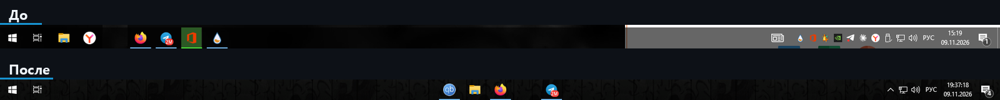

### 2. Notification area (tray)

Extra icons are folded under the `^` arrow, only the system ones stay visible: network, volume, language, clock.

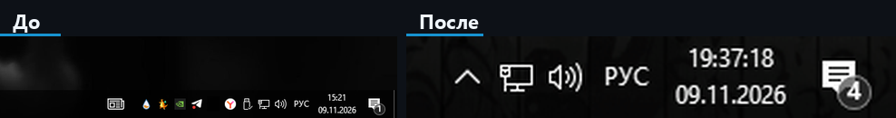

### 3. File Explorer windows

DWMBlurGlass makes window borders and title bars glass, ExplorerBlurMica makes the Explorer background glass.

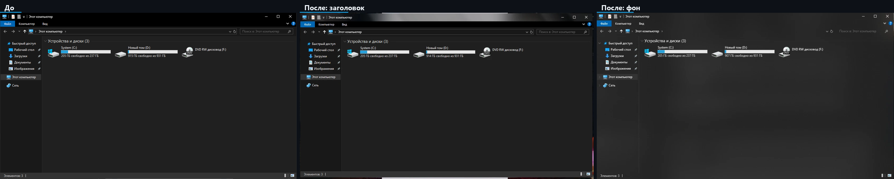

DWMBlurGlass settings:

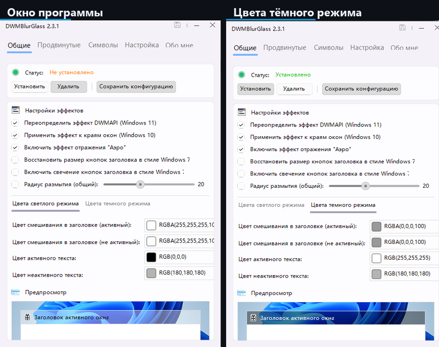

### 4. Terminal

Windows Terminal by default, acrylic, the "Arch Glass" scheme, a Windows 7 splash with system info, a coloured prompt.

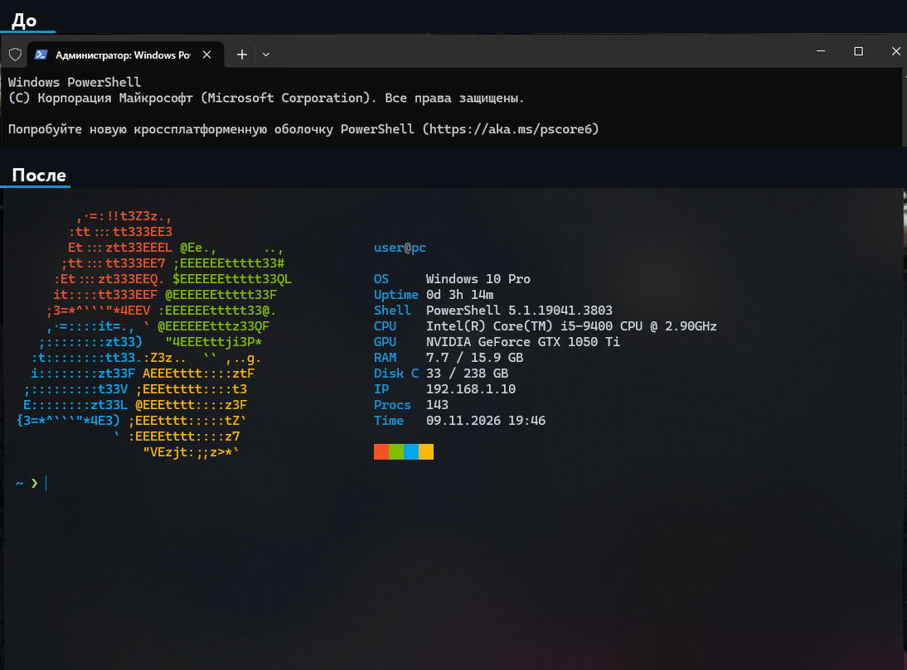

The command prompt (`cmd`) in the same style: splash, `Shell: Command Prompt`, coloured prompt.

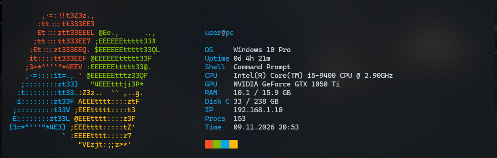

### 5. Context menu

Extra items: "End process" (for `.exe`), "Close hung programs", "Task Manager".

<p align="center">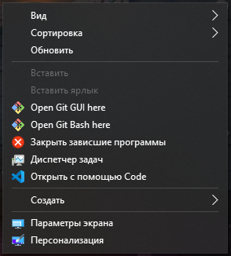</p>

### 6. Mouse actions on the taskbar

7+ Taskbar Tweaker: close a window with the middle button, switch windows with the wheel, Task Manager on double click.

<p align="center">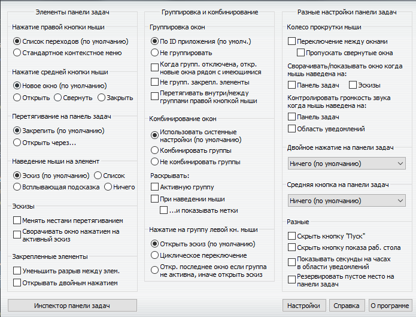</p>

### 7. Load indicator in the tray

One large number next to the `^` arrow: memory fill from 0 to 100. The tooltip shows `RAM` in gigabytes and `CPU`.

<p align="center">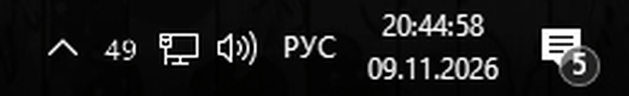</p>

### 8. Quake terminal

`Win + ~` drops the terminal from the top on glass, pressing it again hides it. The prompt shows the git branch (Nerd Font icon).

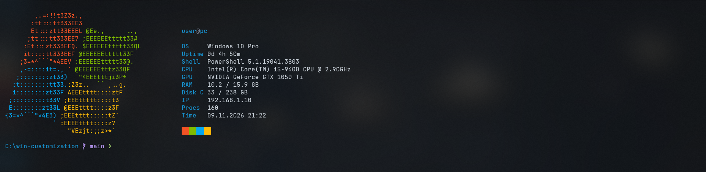

### 9. "Aurora Glass" live wallpaper

My own live wallpaper for Lively Wallpaper: a slowly drifting glow of dark blue, teal and purple gradients. CSS animation only, no scripts, minimal load; Lively pauses it under fullscreen apps.


---

## 🧩 Components

Click a component to expand the details.

<details>
<summary><b>🧭 TaskbarX</b>: centered icons and a transparent taskbar</summary>

<br>

[TaskbarX](https://github.com/ChrisAnd1998/TaskbarX) moves taskbar icons to the center and can restyle the taskbar itself. Version `1.7.8.0` is used.

**How it works.** It runs in the background and smoothly recalculates icon positions whenever the set of icons changes. The taskbar style is set by launch arguments.

**Arguments used:**

- `-tbs=1`: transparent taskbar (`2` blur, `3` acrylic, `4` transparent with gradient, `5` opaque);
- `-color=0;0;0;0`: taskbar colour and opacity as RGBA.

**Installation:** `scripts/01-taskbarx.ps1` downloads the release to `C:\TaskbarX`, creates a shortcut in the real Startup folder and starts the program.

**Notes:**

- TaskbarX exits whenever Explorer is restarted, start it again (script `02` does it for you);
- do not add `-dtbsowm=1`: with a maximized window the taskbar turns plain grey;
- load: about 6 MB of RAM.

</details>

<details>
<summary><b>🪟 DWMBlurGlass</b>: glass on window title bars and borders</summary>

<br>

[DWMBlurGlass](https://github.com/Maplespe/DWMBlurGlass) hooks into the Desktop Window Manager and adds blur and the "Aero" reflection to the title bars and borders of all windows. Version `2.3.1r`.

**How it works.** After you press "Install" the extension is loaded into DWM and its settings (blur amount, colour, opacity) are read from `config.ini`.

**Key settings** (`configs/DWMBlurGlass.config.ini`):

- `blurAmount=35`: blur strength, the higher the "runnier" the glass;
- dark mode colour `RGBA(0,0,0,100)`: black tint with slight transparency;
- Aero reflection and the effect on window edges are on.

**Installation:** `scripts/03-dwmblurglass.ps1` puts the program into `C:\DWMBlurGlass`. Then manually: run `DWMBlurGlass.exe`, press "Install", save the configuration.

**Notes:**

- the program refuses to run from the user profile, so `C:\...` only;
- if there is no glass, download the Windows symbols on the "Symbols" tab, then "Uninstall" and "Install" again;
- rollback: the "Uninstall" button in the program.

</details>

<details>
<summary><b>📁 ExplorerBlurMica</b>: glass background of File Explorer</summary>

<br>

[ExplorerBlurMica](https://github.com/Maplespe/ExplorerBlurMica) makes the background inside File Explorer transparent and blurred: the file list, the side panel and the address bar. Version `2.1.0`.

**How it works.** It is a COM extension for Explorer, registered by `regsvr32` (the `register.cmd` script from the archive), after which Explorer restarts.

**Settings** (`configs/ExplorerBlurMica.config.ini`):

- `effect=2`: plain Mica; `1` acrylic, `4` MicaAlt;
- dark tint: colour `0,0,0`, opacity `a=120`.

**Notes:**

- `effect=3` (clear blur) flickers when a window opens: the window is sharp first and the glass kicks in later, so Mica is used;
- registration is done by a human (UAC), afterwards start TaskbarX again;
- rollback: `uninstall.cmd` in the program folder.

</details>

<details>
<summary><b>🖱 AcrylicMenus and custom context-menu items</b></summary>

<br>

**AcrylicMenus** ([krlvm/AcrylicMenus](https://github.com/krlvm/AcrylicMenus), `v1.0.8`) adds acrylic to classic Win32 context menus. It is experimental: it works in Explorer and on the desktop, custom menus (messengers, Electron) are not affected. Installation is optional, `Install.cmd` is run by a human.

**Custom menu items** (`scripts/06-context-menu-verbs.ps1`, `HKCU` only, no administrator rights needed):

| Where | Item | What it does |
|---|---|---|
| right-click an `.exe` | End process | `taskkill /f /im <name.exe>` |
| desktop / folder background | Close hung programs | `taskkill /f /fi "status eq not responding"` |
| desktop / folder background | Task Manager | `taskmgr.exe` |

**Rollback:** remove the keys `HKCU\Software\Classes\exefile\shell\EndProcess` and `...\Directory\Background\shell\KillHung`, `TaskMgr` (`99-rollback.ps1` does it).

</details>

<details>
<summary><b>🛠 7+ Taskbar Tweaker</b>: mouse actions on the taskbar</summary>

<br>

[7+ Taskbar Tweaker](https://rammichael.com/7-taskbar-tweaker) changes how the Windows taskbar reacts: what a wheel click, a double click or scrolling over the taskbar does.

**Recommended settings:**

- middle button on an icon: "Close";
- wheel over the taskbar: switch between windows;
- double click on an empty spot: "Task Manager";
- right button on an icon: keep the "Jump list".

**Installation:** `scripts/07-taskbar-tweaker.ps1` downloads the installer to `C:\7TaskbarTweaker` and **verifies its digital signature** (publisher Michael Maltsev). If the signature is invalid the file is deleted. The installer itself is run by a human.

</details>

<details>
<summary><b>🖥 Windows Terminal</b>: acrylic, the "Arch Glass" scheme, glass tabs</summary>

<br>

Windows Terminal is installed from the Microsoft Store and becomes the default terminal (`scripts/08-console-defaults.ps1`), so `cmd`, PowerShell and consoles from other programs open in it.

**What is configured** (`configs/windows-terminal.settings.json`):

- acrylic: `useAcrylic=true`, opacity `opacity=72`;
- Cascadia Code 12 font, padding, bar cursor, no scrollbar;
- the "Arch Glass" colour scheme: background `#0b0f14`, accent `#1793d1`;
- glass tab row: `#12171dB8`, the unfocused window is slightly denser;
- a `cmd` profile with a coloured prompt and no grey Microsoft banner.

**Pitfalls:**

- colour schemes accept only the `#rrggbb` format, transparency in `selectionBackground` breaks the whole file;
- a fully transparent tab row makes window buttons vanish when focus is lost, so about 70 % opacity is kept.

</details>

<details>
<summary><b>✨ PowerShell profile and cmd</b>: Windows 7 splash</summary>

<br>

The splash lives in a separate file, `configs/Show-Splash.ps1`, called by both the PowerShell profile (`configs/Microsoft.PowerShell_profile.ps1`) and `cmd` (`configs/cmd-autorun.cmd`). On start it prints a coloured Windows 7 logo and system info: user, OS, uptime, shell, CPU, GPU, memory, disk, IP, process count, time. The prompt is short: a blue path (home folder as `~`, long paths shortened to `…\last\three\folders`) and a green `❯` arrow.

**How the fast start works:**

- static data (OS, CPU, GPU) is cached for 7 days, so heavy WMI queries run rarely;
- everything else is computed without WMI, about 75 ms;
- the splash is shown only in an interactive console, never in scripts or redirected output;
- turn it off: `$env:NO_SPLASH=1`.

**Styling `cmd`.** `configs/cmd-autorun.cmd` is hooked in through `HKCU\Software\Microsoft\Command Processor\AutoRun` and styles any plain interactive `cmd` (from the terminal, `Win + R`, Start): it enables UTF-8, sets a coloured prompt (the path on its own line, the `❯` arrow below) and calls the same splash (`Shell: Command Prompt`). It **does not run** for `cmd /c ...` and `cmd /k ...` started by other programs: the launch type is detected from `%cmdcmdline%` using delayed expansion, so the special characters `& | ! % "` in foreign commands cannot break anything. If the file is removed `cmd` prints no errors (`AutoRun` has an `if exist` check).

**Demo mode for screenshots.** A `splash-demo.json` file next to the profile replaces the name, host and IP with neutral values, handy for public screenshots.

</details>

<details>
<summary><b>📊 SysMonTray</b>: RAM and CPU load indicator in the tray</summary>

<br>

My own small PowerShell script (`configs/SysMonTray.ps1`), no external programs needed. It draws **one icon with a number 0–100** in the notification area: RAM fill. The style is minimal: large white digits, yellow from 75, red from 90.

**How it works.** Every 2 seconds it reads the processor load counter and the memory state (`GlobalMemoryStatusEx`), draws the number into a 32×32 icon using the largest font that still fits, and updates the icon.

**Controls:**

- **left click**: switches the display RAM ↔ CPU;
- **hover**: a tooltip `RAM: 49/100 (7.8/15.9 GB)` and `CPU: 18/100`;
- **right click**: "Show RAM", "Show CPU", "Exit".

**Installation:** `scripts/12-sysmon-tray.ps1` copies the script to `C:\SysMonTray`, creates an autostart shortcut in the real Startup folder and starts it in a hidden window. If the icon is hidden under the `^` arrow, drag it onto the taskbar.

**Notes:**

- a Windows tray tooltip is limited to 63 characters, so the text is short (a longer one stops the icon from updating);
- if ghosts of old icons remain, move the mouse over the tray;
- load: about 40 MB of RAM for the hidden PowerShell process and about 0 % CPU.

</details>

<details>
<summary><b>🔤 Nerd Font and prompt</b>: git branch, command duration, status</summary>

<br>

**Font.** [JetBrainsMono Nerd Font](https://github.com/ryanoasis/nerd-fonts) (`v3.5.1`) is installed for the current user (`scripts/13-nerd-font.ps1`) and set as `JetBrainsMono Nerd Font` in Windows Terminal. It provides the icons in the prompt.

**PowerShell prompt** (`configs/Microsoft.PowerShell_profile.ps1`):

- path: `~` for the home folder, long paths shortened to `…\last\three\folders`;
- git branch with the `` icon (read from `.git/HEAD` up the tree, no `git.exe` call, worktrees supported);
- duration of the last command with a clock icon when it took longer than 0.5 s (`1.3s`, `2m05s`);
- the `❯` arrow is green after success and red after an error;
- rendering costs about 3 ms.

**PSReadLine.** Syntax highlighting in the terminal palette, history search by prefix with ↑/↓, `Tab` menu completion. Grey history predictions are enabled automatically when PSReadLine 2.1+ is present.

**Pitfall.** On this Windows 10 build the newer PSReadLine 2.3.6 and 2.4.5 from the PowerShell Gallery closed the console (exit code 5) on the first key press, even without a profile. So the built-in 2.0.0 is used and the profile checks the version itself.

</details>

<details>
<summary><b>⬇️ Quake mode</b>: <code>Win + ~</code></summary>

<br>

`configs/windows-terminal.settings.json` binds the `quakeMode` action to `win+sc(41)` (the `~` key left of `1`) and enables `minimizeToNotificationArea` so the terminal stays in the tray. The window drops from the top with the same scheme and acrylic, pressing the key again hides it.

**Note:** the hotkey works while Windows Terminal is running (at least minimized to the tray).

</details>

<details>
<summary><b>🎨 Dark theme and accent colour</b>: <code>#1793D1</code></summary>

<br>

`scripts/14-accent-theme.ps1` enables the dark theme for Windows and apps, transparency, and sets the `#1793D1` accent (the same blue as the terminal): a 7-shade palette for Start, links, toggles and selection. Title bars are not tinted, they keep the DWMBlurGlass glass. Previous values are saved to `%USERPROFILE%\accent-backup.json`, `99-rollback.ps1` restores them.

</details>

<details>
<summary><b>🚀 Startup</b>: reversible clean-up</summary>

<br>

`scripts/15-startup-review.ps1` lists everything that starts with Windows and disables the chosen items exactly like "Task Manager → Disable" (via `StartupApproved`, the `Run` entry is kept):

```powershell
.\scripts\15-startup-review.ps1 -Disable 'Mozilla-Firefox-*'
.\scripts\15-startup-review.ps1 -Enable  'Mozilla-Firefox-*'
```

Keep the customization components enabled (TaskbarX, SysMonTray, AcrylicMenus, 7+ Taskbar Tweaker, Lively).

</details>

<details>
<summary><b>🌌 Aurora Glass live wallpaper</b>: Lively Wallpaper</summary>

<br>

My own web wallpaper (`configs/lively/aurora-glass/`): four large radial gradients in the terminal palette drift slowly under a soft vignette and light grain. `transform` animations only (GPU), no JavaScript; animation is off with `prefers-reduced-motion`.

**Installation:** `scripts/16-live-wallpaper.ps1` builds the `C:\LivelyWallpapers\aurora-glass.zip` package and opens [Lively Wallpaper](https://github.com/rocksdanister/lively). Then manually: the `+` button → pick the zip → click "Aurora Glass".

**Pitfall:** `Lively.exe setwp --file` in Lively 2.x does not import new files ("Unsupported command import file"), so the import is done in the app window.

</details>
<details>
<summary><b>🛡 ShellGuard</b>: automatic recovery after an Explorer hang (optional)</summary>

<br>

**What happens.** Sometimes `explorer.exe` hangs, Windows closes it and restarts it (the log shows "Application Hang" and "The shell stopped unexpectedly"). Everything attached to the old Explorer is orphaned: TaskbarX loses the centering and transparency of the taskbar (and may burn CPU idling), Lively loses the desktop backdrop window (`WorkerW`) and only the static wallpaper stays instead of the live one.

**How it works.** `configs/ShellGuard.ps1` compares the Explorer start time with the TaskbarX and Lively start times every 5 seconds. If they are older than Explorer, the guard waits 10 seconds, restarts TaskbarX and fully restarts Lively (re-applying the wallpaper with `setwp` does not work in Lively 2.x in this state). At most once per 90 seconds, everything is logged to `C:\ShellGuard\guard.log`.

**Installation.** `scripts/17-shell-guard.ps1` (part of `Install-Auto.ps1`): copies the script to `C:\ShellGuard`, adds an autostart shortcut and starts it in a hidden window.

- state without changes: `powershell -File C:\ShellGuard\ShellGuard.ps1 -Check`;
- force a repair: `-RepairNow`.

**Notes:** about 40 MB of RAM, CPU close to 0 %; rollback: `scripts/99-rollback.ps1`. It treats the consequences, not the cause of the hang: if Explorer hangs often, try disabling the optional extensions (AcrylicMenus, ExplorerBlurMica).

</details>
<details>
<summary><b>🎨 Wallpapers</b>: dark 4K gradients</summary>

<br>

`scripts/11-wallpaper.ps1` downloads two light dark 4K wallpapers (about 0.4 and 0.6 MB) from [Wallhaven](https://wallhaven.cc) to `C:\Wallpapers` and sets the first one. A dark gradient shows off the transparent taskbar and glass windows best.

</details>

---

## 🚀 Quick start

**One command** (PowerShell; it asks for administrator rights, downloads what is missing, installs everything in order and prints a summary and self-check at the end):

```powershell
irm https://raw.githubusercontent.com/swensi17/win-customization/main/Install.ps1 | iex
```

Only one step stays manual: the Install button in the DWMBlurGlass window. Log: `%TEMP%\win-customization-install.log`.

Or step by step:

1. Download the repository and unpack it, for example to `C:\win-customization`.
2. Open PowerShell in the `scripts` folder:

```powershell
Set-ExecutionPolicy -Scope Process Bypass
.\Install-Auto.ps1
```

3. On steps marked `MANUAL` do the action from the prompt (run an installer, register, UAC) and press Enter.
4. Check the result with the checklist in the [playbook](docs/AGENT_PLAYBOOK.md), section 5.

**Requirements:** Windows 10 x64 (any version and build, Lite included; verified on 22H2, build 19045); Windows Terminal from the Microsoft Store; access to GitHub to download releases.

---

## 🧪 Verifying the setup

After the installation run the self-check script. It changes nothing and prints `OK`, `FAIL` or `skip` for every item:

```powershell
.\scripts\Test-Setup.ps1
```

It checks whether TaskbarX runs and autostarts, whether the tray is folded, the News widget is off, DWMBlurGlass and ExplorerBlurMica are loaded, the context-menu items exist, Windows Terminal is the default, the "Arch Glass" scheme, the PowerShell profile and the cmd styling are applied.

```text
== Taskbar and tray ==
[ OK ] TaskbarX is running
[ OK ] TaskbarX autostart (Startup shortcut)
[ OK ] Tray is folded (EnableAutoTray = 1)
...
Total: 20 OK, 0 FAIL, 0 skipped
```

The exit code equals the number of `FAIL` lines, so the script is handy for automation. Optional components (AcrylicMenus, 7+ Taskbar Tweaker, the DWM check without admin rights) are marked `skip` when absent.

---

## ❓ Troubleshooting

<details>
<summary><b>🪟 No glass on window title bars</b></summary>

<br>

1. Make sure DWMBlurGlass is in `C:\DWMBlurGlass`, not in the user profile: it will not start from there.
2. Open the program and download the Windows symbols on the "Symbols" tab.
3. Press "Uninstall", then "Install", then "Save configuration".
4. Close and reopen the Explorer window.

</details>

<details>
<summary><b>🧭 The taskbar went back to normal, icons on the left</b></summary>

<br>

TaskbarX exits on every Explorer restart (`register.cmd`, installing ExplorerBlurMica and script `02` all restart it). Start it again:

```powershell
& "C:\TaskbarX\TaskbarX.exe" -tbs=1 -color=0;0;0;0
```

If it does not start by itself after a reboot, check that `TaskbarX.lnk` is in `shell:startup` and rerun `scripts/01-taskbarx.ps1`.

</details>

<details>
<summary><b>🖥 Terminal says "Failed to load settings"</b></summary>

<br>

There is an error in `settings.json`. Most often it is a colour with transparency in a scheme (only `#rrggbb` is allowed) or a stray comma. Restore the copy next to the file:

```powershell
$d = "$env:LOCALAPPDATA\Packages\Microsoft.WindowsTerminal_8wekyb3d8bbwe\LocalState"
Copy-Item "$d\settings.json.bak" "$d\settings.json" -Force
```

Or copy `configs/windows-terminal.settings.json` again (step `09`).

</details>

<details>
<summary><b>📂 "Location is not available" or files are not visible</b></summary>

<br>

If the installation is run by a packaged (Microsoft Store) application, writes to `%LOCALAPPDATA%` and `%APPDATA%` land in that application's isolated folder and Explorer does not see them. Fix: keep programs in `C:\...` and put the autostart shortcut at the real path `...\Roaming\Microsoft\Windows\Start Menu\Programs\Startup`.

</details>

<details>
<summary><b>✨ Explorer windows flicker when opening</b></summary>

<br>

`C:\ExplorerBlurMica\Release\config.ini` has `effect=3` (clear blur). Set `effect=2` (Mica) back and restart Explorer.

</details>

<details>
<summary><b>⚙️ The splash does not appear or is slow</b></summary>

<br>

- does not appear: check `Get-ExecutionPolicy -List`, `LocalMachine` must be `RemoteSigned` or looser; make sure `NO_SPLASH` is not set;
- slow on the first run: the data cache is built once, then it is fast;
- turn it off completely: `$env:NO_SPLASH=1` or delete the `$PROFILE` file.

</details>

<details>
<summary><b>🔲 The taskbar turned grey with a maximized window</b></summary>

<br>

`-dtbsowm=1` is left in the TaskbarX launch arguments. Remove it: the correct line is `-tbs=1 -color=0;0;0;0`.

</details>

---

## 🗂 Repository layout

<table width="100%">
  <thead>
    <tr><th align="left">Path</th><th align="left">Purpose<br></th></tr>
  </thead>
  <tbody>
    <tr><td><a href="docs/AGENT_PLAYBOOK.md"><code>docs/AGENT_PLAYBOOK.md</code></a></td><td>step-by-step instruction with <code>AUTO</code> / <code>MANUAL</code> / <code>VERIFY</code> / <code>ROLLBACK</code> / <code>WARN</code> tags (Russian)</td></tr>
    <tr><td><code>scripts/</code></td><td>per-step scripts <code>00</code>…<code>17</code>, rollback <code>99-rollback.ps1</code>, run-everything <code>Install-Auto.ps1</code></td></tr>
    <tr><td><code>scripts/Test-Setup.ps1</code></td><td>verifies the setup (OK / FAIL per item)</td></tr>
    <tr><td><code>configs/</code></td><td>ready-made configs: Windows Terminal, PowerShell profile, DWMBlurGlass, ExplorerBlurMica</td></tr>
    <tr><td><code>screenshots/</code></td><td>before / after frames, the demo gif</td></tr>
    <tr><td><code>docs/social-preview.png</code></td><td>image for the link preview in social networks</td></tr>
    <tr><td><a href="CONTRIBUTING.md"><code>CONTRIBUTING.md</code></a>, <a href="CHANGELOG.md"><code>CHANGELOG.md</code></a></td><td>contribution rules and version history</td></tr>
  </tbody>
</table>

---

## ⚠️ Limitations

- Glass applies to window title bars and borders, File Explorer and classic menus. The Settings window, the Store, browsers and many messengers draw their own background, so they do not turn into glass.
- Some components hook into system processes. Install at your own risk, the rollback is described below.
- Designed for all Windows 10 x64 versions. Fully verified on 22H2 (build 19045), including the lightweight Windows 10 Lite build by Flibustier. On other builds run `Test-Setup.ps1` and check the \
- All third-party programs belong to their authors, source links are listed in the "Components" section.
- The flags on the language buttons come from [flag-icons](https://github.com/lipis/flag-icons) (MIT licence).

---

## ♻️ Rollback

```powershell
.\scripts\99-rollback.ps1
```

Manual components are removed the usual way: DWMBlurGlass ("Uninstall"), `uninstall.cmd` of ExplorerBlurMica and AcrylicMenus, the 7+ Taskbar Tweaker uninstaller. Then delete the folders in `C:\`.

---

## 💖 Support

If this repository helped you, you can support my work. It is optional but always appreciated.

<p>
  <a href="https://t.me/tribute/app?startapp=ep_7qdvBb34zk7b1QW4bCTfA7YXRfpCz2PJoV25omHd06QXD9Lw7d">
    
  </a>
  <a href="https://github.com/swensi17/win-customization">
    
  </a>
</p>

Thank you! 💖

---

<p align="center">
  
</p>

<p align="center">
  <code>© 2026-present <a href="https://github.com/swensi17">swensi17</a></code>
</p>

<p align="center">
  <a href="LICENSE"></a>
</p>
