<h1 align="center">🪟 win-customization</h1>

<p align="center">
  <a href="README.md"></a>
  <a href="README.en.md"></a>
  <a href="README.zh.md"></a>
</p>

<p align="center">
  Windows 10 в стиле «жидкое стекло»: центрированная прозрачная панель задач, размытые окна,<br>
  стеклянный Проводник, терминал с акрилом и заставкой Windows 7. Всё воспроизводится скриптами.<br>
  <sub>Windows 10 liquid-glass setup: centered transparent taskbar, blurred windows, acrylic terminal. Fully scripted.</sub>
</p>

<p align="center">
  
  
  
  
  <a href="https://github.com/swensi17/win-customization/stargazers"></a>
  
  <a href="https://github.com/swensi17/win-customization/releases"></a>
</p>

<p align="center">
  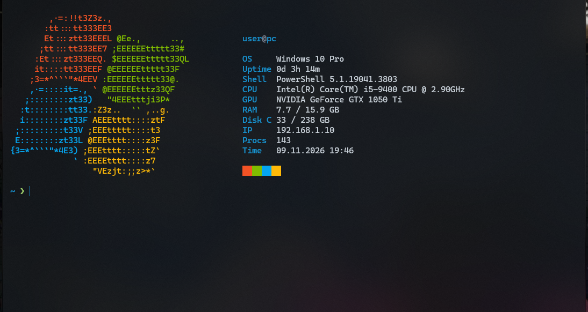
</p>

<p align="center">
  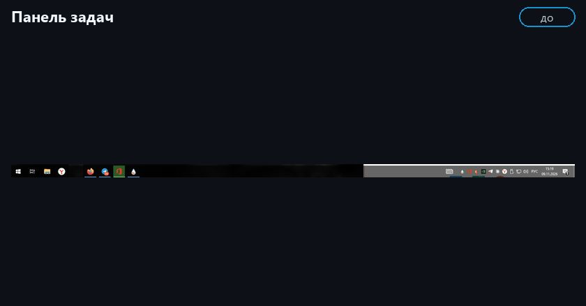<br>
  <sub>До → после по сценам: панель, Проводник, терминал, cmd, индикатор (по кругу)</sub>
</p>

---

## 📑 Содержание

- [✨ Обзор](#-обзор)
- [🖼 Результат: до и после](#-результат-до-и-после)
- [🧩 Компоненты](#-компоненты)
- [🚀 Быстрый старт](#-быстрый-старт)
- [📋 Шаги установки](#-шаги-установки)
- [🧪 Проверка установки](#-проверка-установки)
- [❓ Частые проблемы](#-частые-проблемы)
- [🗂 Структура репозитория](#-структура-репозитория)
- [⚠️ Ограничения](#️-ограничения)
- [♻️ Откат](#️-откат)
- [💖 Поддержать](#-поддержать)

---

## ✨ Обзор

Windows 10 «из коробки» не умеет прозрачность и размытие как Windows 11: панель задач слева и плотная, окна серые, консоль выглядит как в девяностых. Этот репозиторий собирает рабочую связку небольших программ и настроек, которая приближает систему к современному виду, не заменяя её другим ПО.

**Что получится:**

- 🧭 иконки панели задач по центру и полностью прозрачная панель, «Новости» выключены, трей чистый;
- 🪟 размытое тёмное стекло на заголовках и рамках всех окон;
- 📁 стеклянный фон внутри Проводника;
- 🖱 свои пункты в меню ПКМ: «Завершить процесс», «Закрыть зависшие программы», «Диспетчер задач»;
- 🖥 Windows Terminal по умолчанию: акрил, своя цветовая схема, заставка с логотипом Windows 7 и данными о системе;
- 📊 индикатор нагрузки в трее: число 0–100 (заполнение RAM, клик переключает на CPU), подсказка с гигабайтами;
- 🔤 Nerd Font и приглашение с веткой git, временем выполнения команды и цветом стрелки по результату;
- ⬇️ Quake-терминал: `Win + ~` выдвигает терминал сверху на стекле;
- 🎨 тёмная тема везде и акцентный цвет `#1793D1` под палитру; чистая автозагрузка;
- 🌌 живые обои «Aurora Glass» для Lively: тёмные градиенты в той же палитре;
- 🔁 всё ставится скриптами, ручные шаги отмечены, откат одним скриптом.

**Принципы:**

- программы лежат в корне диска `C:\`, а не в профиле пользователя (некоторые из них иначе не запускаются);
- каждый шаг независим и проверяется отдельно;
- ничего не удаляется «навсегда»: перед заменой настройки копируются в `.bak`;
- нагрузка минимальна: около 40 МБ ОЗУ суммарно, процессор около 0 %.

---

## 🖼 Результат: до и после

### 1. Панель задач

Иконки по центру, панель прозрачная, виджет «Новости» выключен.

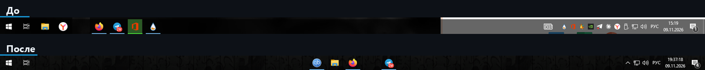

### 2. Область уведомлений (трей)

Лишние значки свёрнуты под стрелку `^`, на виду остаются только системные: сеть, громкость, язык, часы.

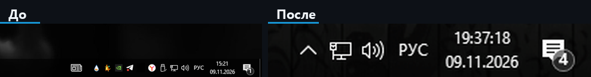

### 3. Окна Проводника

DWMBlurGlass делает стеклянными рамки и заголовки окон, ExplorerBlurMica делает стеклом фон внутри Проводника.

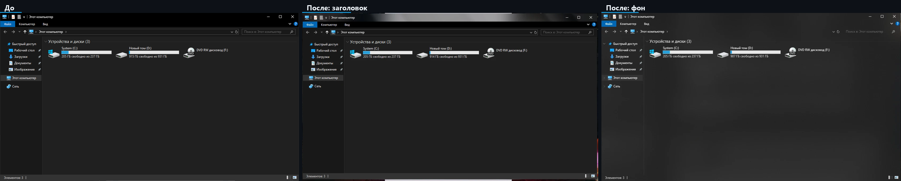

Настройка DWMBlurGlass:

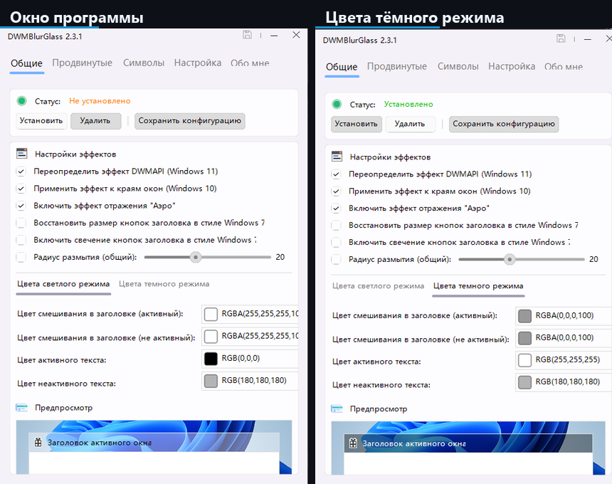

### 4. Терминал

Windows Terminal по умолчанию, акрил, схема «Arch Glass», заставка с логотипом Windows 7 и данными о системе, цветное приглашение.

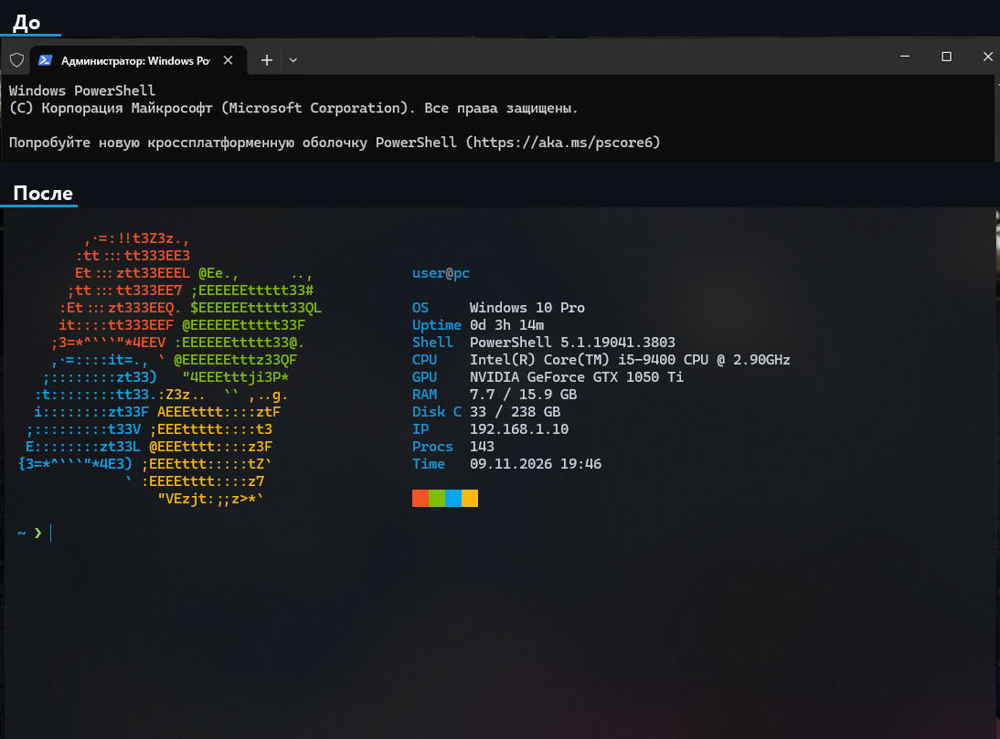

Командная строка (cmd) в том же оформлении: заставка, Shell: Command Prompt, цветное приглашение.

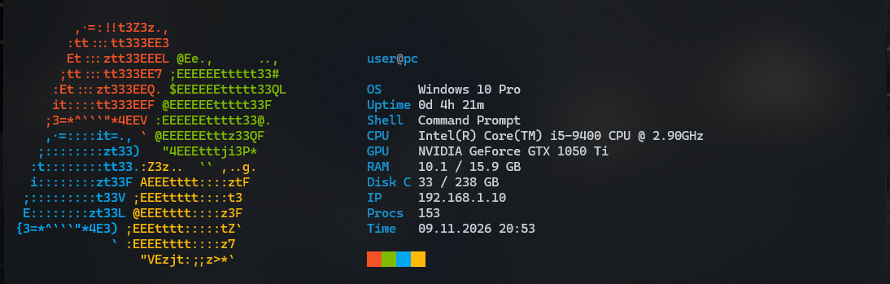

### 5. Контекстное меню

Свои пункты в меню ПКМ: «Завершить процесс» (для `.exe`), «Закрыть зависшие программы», «Диспетчер задач».

<p align="center">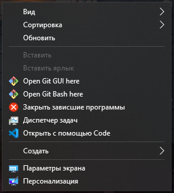</p>

### 6. Действия мыши на панели задач

7+ Taskbar Tweaker: закрытие окна средней кнопкой, переключение окон колесом, диспетчер задач по двойному клику.

<p align="center">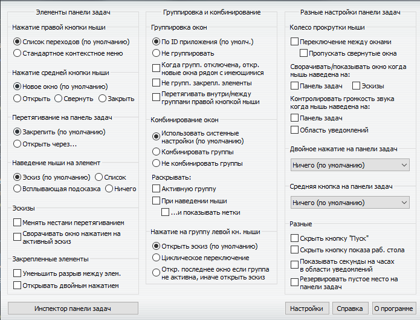</p>

### 7. Индикатор нагрузки в трее

Одно крупное число рядом со стрелкой `^`: заполнение памяти от 0 до 100. При наведении видно `RAM` в гигабайтах и `CPU`.

<p align="center">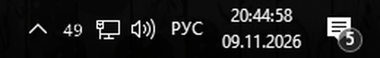</p>

### 8. Quake-терминал

`Win + ~` выдвигает терминал сверху на стекле, повторное нажатие прячет. В приглашении видна ветка git (иконка из Nerd Font).

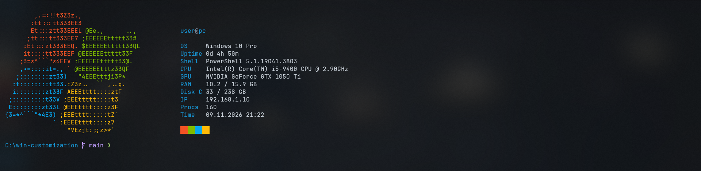

### 9. Живые обои «Aurora Glass»

Свои живые обои для Lively Wallpaper: медленно плывущее сияние тёмно-синих, бирюзовых и фиолетовых градиентов. Только CSS-анимация, без скриптов, нагрузка минимальная; на полноэкранных приложениях Lively ставит их на паузу.


---

## 🧩 Компоненты

Нажми на компонент, чтобы развернуть подробности.

<details>
<summary><b>🧭 TaskbarX</b>: иконки по центру и прозрачная панель</summary>

<br>

[TaskbarX](https://github.com/ChrisAnd1998/TaskbarX) сдвигает иконки панели задач к центру и умеет менять стиль самой панели. В репозитории используется версия `1.7.8.0`.

**Как работает.** Программа висит в фоне и при каждом изменении набора иконок плавно пересчитывает их положение. Стиль панели задаётся параметрами запуска.

**Параметры, которые используются:**

- `-tbs=1`: прозрачная панель (`2` размытие, `3` акрил, `4` прозрачная с градиентом, `5` непрозрачная);
- `-color=0;0;0;0`: цвет и прозрачность панели в формате RGBA.

**Установка:** `scripts/01-taskbarx.ps1` скачивает релиз в `C:\TaskbarX`, создаёт ярлык в настоящей папке автозагрузки и запускает программу.

**На что обратить внимание:**

- при перезапуске Проводника TaskbarX закрывается, его нужно запустить снова (скрипт `02` делает это сам);
- не добавляй `-dtbsowm=1`: при развёрнутом окне панель станет обычной серой;
- нагрузка: около 6 МБ ОЗУ.

</details>

<details>
<summary><b>🪟 DWMBlurGlass</b>: стекло на заголовках и рамках окон</summary>

<br>

[DWMBlurGlass](https://github.com/Maplespe/DWMBlurGlass) встраивается в диспетчер окон Windows (DWM) и добавляет размытие и отражение «Аэро» на заголовки и рамки всех окон. Версия `2.3.1r`.

**Как работает.** После кнопки «Установить» расширение подгружается в DWM, а настройки (степень размытия, цвет, прозрачность) читаются из `config.ini`.

**Ключевые настройки** (в `configs/DWMBlurGlass.config.ini`):

- `blurAmount=35`: сила размытия, чем больше число, тем «жиже» стекло;
- цвет тёмного режима `RGBA(0,0,0,100)`: чёрный оттенок с лёгкой прозрачностью;
- включены отражение «Аэро» и эффект на краях окон.

**Установка:** `scripts/03-dwmblurglass.ps1` кладёт программу в `C:\DWMBlurGlass`. Дальше вручную: запустить `DWMBlurGlass.exe`, нажать «Установить», сохранить конфигурацию.

**На что обратить внимание:**

- программа отказывается работать из папки пользователя, поэтому только `C:\...`;
- если стекла нет, на вкладке «Символы» нужно скачать символы Windows, затем «Удалить» и «Установить» заново;
- откат: кнопка «Удалить» в самой программе.

</details>

<details>
<summary><b>📁 ExplorerBlurMica</b>: стеклянный фон Проводника</summary>

<br>

[ExplorerBlurMica](https://github.com/Maplespe/ExplorerBlurMica) делает прозрачным и размытым фон внутри окна Проводника: список файлов, боковую панель и адресную строку. Версия `2.1.0`.

**Как работает.** Это COM-расширение Проводника. Его регистрирует `regsvr32` (скрипт `register.cmd` из архива), после чего Проводник перезапускается.

**Настройки** (`configs/ExplorerBlurMica.config.ini`):

- `effect=2`: обычный Mica; `1` акрил, `4` MicaAlt;
- тёмный оттенок: цвет `0,0,0`, прозрачность `a=120`.

**На что обратить внимание:**

- `effect=3` (чистое размытие) на практике даёт «моргание» при открытии окна: оно сначала резкое, потом включается стекло, поэтому оставлен Mica;
- регистрацию запускает человек (UAC), после неё нужно заново запустить TaskbarX;
- откат: `uninstall.cmd` в папке программы.

</details>

<details>
<summary><b>🖱 AcrylicMenus и свои пункты меню ПКМ</b></summary>

<br>

**AcrylicMenus** ([krlvm/AcrylicMenus](https://github.com/krlvm/AcrylicMenus), `v1.0.8`) добавляет акрил классическим контекстным меню Win32. Проект экспериментальный: работает в Проводнике и на рабочем столе, нестандартные меню (мессенджеры, Electron) не затрагивает. Установка необязательна, `Install.cmd` запускает человек.

**Свои пункты меню** (скрипт `scripts/06-context-menu-verbs.ps1`, только `HKCU`, права администратора не нужны):

| Где | Пункт | Что делает |
|---|---|---|
| ПКМ по `.exe` | Завершить процесс | `taskkill /f /im <имя.exe>` |
| Фон рабочего стола и папок | Закрыть зависшие программы | `taskkill /f /fi "status eq not responding"` |
| Фон рабочего стола и папок | Диспетчер задач | `taskmgr.exe` |

**Откат:** удалить ключи `HKCU\Software\Classes\exefile\shell\EndProcess` и `...\Directory\Background\shell\KillHung`, `TaskMgr` (делает `99-rollback.ps1`).

</details>

<details>
<summary><b>🛠 7+ Taskbar Tweaker</b>: действия мыши на панели задач</summary>

<br>

[7+ Taskbar Tweaker](https://rammichael.com/7-taskbar-tweaker) меняет поведение панели задач Windows: что происходит по клику колесом, по двойному клику, при прокрутке над панелью.

**Рекомендуемые настройки:**

- средняя кнопка по значку: «Закрыть»;
- колесо над панелью: переключение между окнами;
- двойной клик по пустому месту: «Диспетчер задач»;
- правая кнопка по значку: оставить «Список переходов».

**Установка:** `scripts/07-taskbar-tweaker.ps1` скачивает установщик в `C:\7TaskbarTweaker` и **проверяет цифровую подпись** (издатель Michael Maltsev). При невалидной подписи файл удаляется. Сам установщик запускает человек.

</details>

<details>
<summary><b>🖥 Windows Terminal</b>: акрил, схема «Arch Glass», вкладки-стекло</summary>

<br>

Windows Terminal ставится из Microsoft Store и становится терминалом по умолчанию (`scripts/08-console-defaults.ps1`), так что `cmd`, PowerShell и консоль из других программ открываются в нём.

**Что настроено** (`configs/windows-terminal.settings.json`):

- акрил: `useAcrylic=true`, прозрачность `opacity=72`;
- шрифт Cascadia Code 12, отступы по краям, курсор-палка, без полосы прокрутки;
- цветовая схема «Arch Glass»: фон `#0b0f14`, акцент `#1793d1`;
- строка вкладок со стеклом: `#12171dB8`, неактивное окно чуть плотнее;
- профиль cmd с цветным приглашением и без серого баннера Microsoft.

**Ловушки:**

- в схемах цветов допустим только формат `#rrggbb`, прозрачность в `selectionBackground` ломает загрузку всего файла;
- полностью прозрачная строка вкладок даёт пропадающие кнопки при потере фокуса, поэтому у неё оставлена непрозрачность около 70 %.

</details>

<details>
<summary><b>✨ Профиль PowerShell и cmd</b>: заставка с логотипом Windows 7</summary>

<br>

Заставка вынесена в отдельный файл `configs/Show-Splash.ps1`, его вызывают и профиль PowerShell (`configs/Microsoft.PowerShell_profile.ps1`), и `cmd` (`configs/cmd-autorun.cmd`). Она выводит при запуске цветной логотип Windows 7 и данные о системе: пользователь, ОС, аптайм, оболочка, процессор, видеокарта, память, диск, IP, число процессов, время. Приглашение короткое: голубой путь (домашняя папка как `~`, длинные пути сокращаются до `…\последние\три\папки`) и зелёная стрелка `❯`.

**Как сделан быстрый старт:**

- статичные данные (ОС, процессор, видеокарта) кэшируются на 7 дней, поэтому тяжёлые WMI-запросы выполняются редко;
- остальное считается без WMI, это около 75 мс;
- заставка показывается только в интерактивной консоли, в скриптах и перенаправленном выводе её нет;
- отключить: `$env:NO_SPLASH=1`.

**Оформление cmd.** Скрипт `configs/cmd-autorun.cmd` подключается через `HKCU\Software\Microsoft\Command Processor\AutoRun` и оформляет любой обычный интерактивный `cmd` (из терминала, `Win + R`, «Пуск»): включает UTF-8, задаёт цветное приглашение (путь отдельной строкой, ниже стрелка `❯`) и вызывает ту же заставку (`Shell: Command Prompt`). Он **не срабатывает** для `cmd /c ...` и `cmd /k ...` из других программ: тип запуска определяется по `%cmdcmdline%` через отложенное раскрытие переменных, поэтому спецсимволы `& | ! % "` в чужих командах ничего не ломают. Если файл удалить, `cmd` не выдаёт ошибок (в `AutoRun` стоит проверка `if exist`).
**Демо-режим для скриншотов.** Файл `splash-demo.json` рядом с профилем подменяет имя, хост и IP на нейтральные, удобно для публичных скриншотов.

</details>

<details>
<summary><b>📊 SysMonTray</b>: индикатор нагрузки RAM и CPU в трее</summary>

<br>

Свой небольшой скрипт PowerShell (`configs/SysMonTray.ps1`), внешние программы не нужны. Рисует в области уведомлений **один значок с числом 0–100**: заполнение оперативной памяти. Стиль минималистичный: крупные белые цифры, жёлтые от 75, красные от 90.

**Как работает.** Каждые 2 секунды читает счётчик загрузки процессора и состояние памяти (`GlobalMemoryStatusEx`), рисует число в иконку 32×32 с самым крупным шрифтом, при котором оно помещается, и обновляет значок.

**Управление:**

- **левый клик**: переключает показ RAM ↔ CPU;
- **наведение**: подсказка `RAM: 49/100 (7.8/15.9 ГБ)` и `CPU: 18/100`;
- **правый клик**: «Показывать RAM», «Показывать CPU», «Выход».

**Установка:** `scripts/12-sysmon-tray.ps1` копирует скрипт в `C:\SysMonTray`, создаёт ярлык автозапуска в настоящей папке Startup и запускает его скрытым окном. Если значок спрятан под стрелкой `^`, перетащи его на панель задач.

**На что обратить внимание:**

- подсказка значка в Windows ограничена 63 символами, поэтому текст короткий (длиннее значок перестаёт обновляться);
- если рядом остаются «призраки» старых значков, проведи мышью по трею;
- нагрузка: около 40 МБ ОЗУ у скрытого процесса PowerShell и около 0 % процессора;
- откат: `scripts/99-rollback.ps1` или правый клик по значку → «Выход» и удаление ярлыка из `shell:startup`.

</details>
<details>
<summary><b>🔤 Nerd Font и приглашение</b>: ветка git, время команды, статус</summary>

<br>

**Шрифт.** [JetBrainsMono Nerd Font](https://github.com/ryanoasis/nerd-fonts) (`v3.5.1`) ставится для текущего пользователя (`scripts/13-nerd-font.ps1`), в Windows Terminal он задан как `JetBrainsMono Nerd Font`. Нужен для иконок в приглашении.

**Приглашение PowerShell** (`configs/Microsoft.PowerShell_profile.ps1`):

- путь: `~` для домашней папки, длинные пути сокращаются до `…\последние\три\папки`;
- ветка git с иконкой `` (определяется чтением `.git/HEAD` вверх по дереву, без запуска `git.exe`, поддерживаются worktree);
- время выполнения последней команды с иконкой часов, если она шла дольше 0,5 с (`1.3s`, `2m05s`);
- стрелка `❯` зелёная после успешной команды и красная после ошибки;
- стоимость отрисовки около 3 мс.

**PSReadLine.** Подсветка синтаксиса в палитре терминала, поиск по истории стрелками ↑/↓ по набранному началу, `Tab` с меню вариантов. Серые подсказки из истории включаются автоматически, если стоит PSReadLine 2.1+.

**Ловушка.** На этой сборке Windows 10 новые PSReadLine 2.3.6 и 2.4.5 из PowerShell Gallery закрывали консоль (код 5) на первом нажатии клавиши, даже без профиля. Поэтому используется встроенный 2.0.0, а профиль сам проверяет версию.

</details>

<details>
<summary><b>⬇️ Quake-режим терминала</b>: <code>Win + ~</code></summary>

<br>

В `configs/windows-terminal.settings.json` добавлено действие `quakeMode` на `win+sc(41)` (клавиша `~`/`ё` слева от `1`) и `minimizeToNotificationArea`, чтобы терминал оставался в трее. Окно выезжает сверху, использует ту же схему и акрил, повторное нажатие прячет его.

**На что обратить внимание:** горячая клавиша работает, пока запущен Windows Terminal (хотя бы свёрнутым в трей).

</details>

<details>
<summary><b>🎨 Тёмная тема и акцентный цвет</b>: <code>#1793D1</code></summary>

<br>

`scripts/14-accent-theme.ps1` включает тёмную тему для Windows и приложений, прозрачность и ставит акцентный цвет `#1793D1` (тот же голубой, что в терминале): палитра из 7 оттенков для меню «Пуск», ссылок, переключателей и выделения. Заголовки окон акцентом не красятся, там остаётся стекло DWMBlurGlass. Прежние значения сохраняются в `%USERPROFILE%\accent-backup.json`, откат через `99-rollback.ps1`.

</details>

<details>
<summary><b>🚀 Автозагрузка</b>: обратимое отключение лишнего</summary>

<br>

`scripts/15-startup-review.ps1` показывает всё, что стартует вместе с Windows, и отключает выбранное так же, как «Диспетчер задач → Отключить» (через `StartupApproved`, запись в `Run` не удаляется):

```powershell
.\scripts\15-startup-review.ps1 -Disable 'Mozilla-Firefox-*'
.\scripts\15-startup-review.ps1 -Enable  'Mozilla-Firefox-*'
```

Компоненты оформления (TaskbarX, SysMonTray, AcrylicMenus, 7+ Taskbar Tweaker, Lively) должны оставаться включёнными.

</details>

<details>
<summary><b>🌌 Живые обои Aurora Glass</b>: Lively Wallpaper</summary>

<br>

Свои веб-обои (`configs/lively/aurora-glass/`): четыре больших радиальных градиента в палитре терминала медленно плывут, сверху мягкая виньетка и лёгкое зерно. Только `transform`-анимации (GPU), без JavaScript; при `prefers-reduced-motion` анимация выключается.

**Установка:** `scripts/16-live-wallpaper.ps1` собирает пакет `C:\LivelyWallpapers\aurora-glass.zip` и открывает [Lively Wallpaper](https://github.com/rocksdanister/lively). Дальше вручную: кнопка `+` → выбрать zip → кликнуть по «Aurora Glass».

**Ловушка:** команда `Lively.exe setwp --file` в Lively 2.x не импортирует новые файлы («Unsupported command import file»), поэтому импорт делается через окно программы.

</details>
<details>
<summary><b>🎨 Обои</b>: тёмные градиенты 4K</summary>

<br>

Скрипт `scripts/11-wallpaper.ps1` скачивает два лёгких тёмных обоя в 4K (около 0,4 и 0,6 МБ) с [Wallhaven](https://wallhaven.cc) в `C:\Wallpapers` и ставит первый на рабочий стол. Тёмный градиент лучше всего показывает прозрачную панель и стеклянные окна.

</details>

---

## 🚀 Быстрый старт

1. Скачать репозиторий и распаковать, например, в `C:\win-customization`.
2. Открыть PowerShell в папке `scripts`:

```powershell
Set-ExecutionPolicy -Scope Process Bypass
.\Install-Auto.ps1
```

3. На шагах с пометкой `MANUAL` выполнить действие из подсказки (запуск установщика, регистрация, UAC) и нажать Enter.
4. Проверить результат по чек-листу в [playbook](docs/AGENT_PLAYBOOK.md), раздел 5.

**Требования:** Windows 10 22H2 (build 19045), x64; Windows Terminal из Microsoft Store; доступ к GitHub для загрузки релизов.

---

## 📋 Шаги установки

<table width="100%">
  <thead>
    <tr><th align="left">#</th><th align="left">Шаг</th><th align="left">Тип<br></th></tr>
  </thead>
  <tbody>
    <tr><td>00</td><td>проверка окружения</td><td><code>AUTO</code></td></tr>
    <tr><td>01</td><td>TaskbarX: центр и прозрачность</td><td><code>AUTO</code></td></tr>
    <tr><td>02</td><td>трей и виджет «Новости»</td><td><code>AUTO</code></td></tr>
    <tr><td>03</td><td>DWMBlurGlass</td><td><code>AUTO</code> + <code>MANUAL</code></td></tr>
    <tr><td>04</td><td>ExplorerBlurMica</td><td><code>AUTO</code> + <code>MANUAL</code></td></tr>
    <tr><td>05</td><td>AcrylicMenus</td><td><code>AUTO</code> + <code>MANUAL</code></td></tr>
    <tr><td>06</td><td>свои пункты в меню ПКМ</td><td><code>AUTO</code></td></tr>
    <tr><td>07</td><td>7+ Taskbar Tweaker</td><td><code>AUTO</code> + <code>MANUAL</code></td></tr>
    <tr><td>08</td><td>консоль и терминал по умолчанию</td><td><code>AUTO</code></td></tr>
    <tr><td>09</td><td>настройки Windows Terminal</td><td><code>AUTO</code></td></tr>
    <tr><td>10</td><td>профиль PowerShell и оформление cmd</td><td><code>AUTO</code></td></tr>
    <tr><td>11</td><td>обои</td><td><code>AUTO</code></td></tr>
    <tr><td>12</td><td>индикатор нагрузки в трее</td><td><code>AUTO</code></td></tr>
    <tr><td>13</td><td>Nerd Font для терминала</td><td><code>AUTO</code></td></tr>
    <tr><td>14</td><td>тёмная тема и акцентный цвет</td><td><code>AUTO</code></td></tr>
    <tr><td>15</td><td>обзор и чистка автозагрузки</td><td><code>AUTO</code></td></tr>
    <tr><td>16</td><td>живые обои Aurora Glass (Lively)</td><td><code>AUTO</code> + <code>MANUAL</code></td></tr>
  </tbody>
</table>

Каждый шаг подробно расписан в [playbook](docs/AGENT_PLAYBOOK.md): что делает, как проверить, как откатить и какие есть ловушки.

---

## 🧪 Проверка установки

После установки запусти скрипт самопроверки. Он ничего не меняет и показывает по каждому пункту `OK`, `FAIL` или `skip`:

```powershell
.\scripts\Test-Setup.ps1
```

Что проверяется: запущен ли TaskbarX и есть ли автозапуск, свёрнут ли трей, выключены ли «Новости», загружены ли DWMBlurGlass и ExplorerBlurMica, на месте ли пункты меню ПКМ, стоит ли Windows Terminal по умолчанию, применены ли схема «Arch Glass» и профиль PowerShell.

```text
== Панель задач и трей ==
[ OK ] TaskbarX запущен
[ OK ] TaskbarX в автозагрузке (ярлык в Startup)
[ OK ] Трей свёрнут (EnableAutoTray = 1)
...
Итого: 17 OK, 0 FAIL, 0 пропущено
```

Код выхода равен числу `FAIL`, так что скрипт удобно использовать в автоматизации. Необязательные компоненты (AcrylicMenus, 7+ Taskbar Tweaker, проверка DWM без прав администратора) при отсутствии помечаются как `skip`.

---

## ❓ Частые проблемы

<details>
<summary><b>🪟 Нет стекла на заголовках окон</b></summary>

<br>

1. Убедись, что DWMBlurGlass лежит в `C:\DWMBlurGlass`, а не в профиле пользователя: оттуда он не запускается.
2. Открой программу, на вкладке «Символы» скачай символы Windows.
3. Нажми «Удалить», затем «Установить», затем «Сохранить конфигурацию».
4. Закрой и снова открой окно Проводника.

</details>

<details>
<summary><b>🧭 Панель вернулась в обычный вид, иконки слева</b></summary>

<br>

TaskbarX закрывается при каждом перезапуске Проводника (его делают `register.cmd`, установка ExplorerBlurMica и скрипт `02`). Запусти его снова:

```powershell
& "C:\TaskbarX\TaskbarX.exe" -tbs=1 -color=0;0;0;0
```

Если после перезагрузки он не стартует сам, проверь, что ярлык `TaskbarX.lnk` лежит в `shell:startup`, и перезапусти `scripts/01-taskbarx.ps1`.

</details>

<details>
<summary><b>🖥 Терминал пишет «Не удалось загрузить параметры»</b></summary>

<br>

В `settings.json` ошибка. Чаще всего это цвет с прозрачностью в схеме (допустим только `#rrggbb`) или лишняя запятая. Восстанови копию рядом с файлом:

```powershell
$d = "$env:LOCALAPPDATA\Packages\Microsoft.WindowsTerminal_8wekyb3d8bbwe\LocalState"
Copy-Item "$d\settings.json.bak" "$d\settings.json" -Force
```

Либо заново скопируй `configs/windows-terminal.settings.json` (шаг `09`).

</details>

<details>
<summary><b>📂 «Расположение недоступно» или файлов не видно</b></summary>

<br>

Если установку выполняет упакованное приложение (из Microsoft Store), запись в `%LOCALAPPDATA%` и `%APPDATA%` попадает в изолированную папку этого приложения, и Проводник её не видит. Решение: программы всегда в `C:\...`, ярлык автозагрузки по настоящему пути `...\Roaming\Microsoft\Windows\Start Menu\Programs\Startup`.

</details>

<details>
<summary><b>✨ Окна Проводника «моргают» при открытии</b></summary>

<br>

В `C:\ExplorerBlurMica\Release\config.ini` стоит `effect=3` (чистое размытие). Верни `effect=2` (Mica) и перезапусти Проводник.

</details>

<details>
<summary><b>⚙️ Заставка не появляется или тормозит</b></summary>

<br>

- не появляется: проверь `Get-ExecutionPolicy -List`, для `LocalMachine` должно быть `RemoteSigned` или мягче; убедись, что не задана переменная `NO_SPLASH`;
- тормозит при первом запуске: кэш данных создаётся один раз, дальше быстро;
- отключить совсем: `$env:NO_SPLASH=1` или удалить профиль `$PROFILE`.

</details>

<details>
<summary><b>🔲 Панель стала серой при развёрнутом окне</b></summary>

<br>

В параметрах запуска TaskbarX остался `-dtbsowm=1`. Убери его: правильная строка `-tbs=1 -color=0;0;0;0`.

</details>

---

## 🗂 Структура репозитория

<table width="100%">
  <thead>
    <tr><th align="left">Путь</th><th align="left">Назначение<br></th></tr>
  </thead>
  <tbody>
    <tr><td><a href="docs/AGENT_PLAYBOOK.md"><code>docs/AGENT_PLAYBOOK.md</code></a></td><td>пошаговая инструкция с тегами <code>AUTO</code> / <code>MANUAL</code> / <code>VERIFY</code> / <code>ROLLBACK</code> / <code>WARN</code></td></tr>
    <tr><td><code>scripts/</code></td><td>скрипты по шагам <code>00</code>…<code>16</code>, откат <code>99-rollback.ps1</code>, запуск всего <code>Install-Auto.ps1</code></td></tr>
    <tr><td><code>scripts/Test-Setup.ps1</code></td><td>проверка результата установки (OK / FAIL по каждому пункту)</td></tr>
    <tr><td><code>configs/</code></td><td>готовые конфиги: Windows Terminal, профиль PowerShell, DWMBlurGlass, ExplorerBlurMica, живые обои Lively</td></tr>
    <tr><td><code>screenshots/</code></td><td>кадры «до» и «после», демо-гифка</td></tr>
    <tr><td><code>docs/social-preview.png</code></td><td>картинка для предпросмотра ссылки в соцсетях</td></tr>
    <tr><td><a href="CONTRIBUTING.md"><code>CONTRIBUTING.md</code></a>, <a href="CHANGELOG.md"><code>CHANGELOG.md</code></a></td><td>правила для вклада и история версий</td></tr>
  </tbody>
</table>

---

## ⚠️ Ограничения

- Стекло получают заголовки и рамки окон, Проводник и классические меню. Окно «Параметры», Магазин, браузеры и многие мессенджеры рисуют фон сами, поэтому стеклянными не становятся.
- Часть компонентов встраивается в системные процессы. Устанавливайте на свой риск, откат описан ниже.
- Рассчитано на Windows 10 22H2 (build 19045), x64. На других версиях поведение не проверялось.
- Все сторонние программы принадлежат своим авторам, ссылки на источники приведены в разделе «Компоненты».

---

## ♻️ Откат

```powershell
.\scripts\99-rollback.ps1
```

Ручные компоненты снимаются штатно: DWMBlurGlass («Удалить»), `uninstall.cmd` у ExplorerBlurMica и AcrylicMenus, деинсталлятор 7+ Taskbar Tweaker. Затем удалить папки в `C:\`.

---

## 💖 Поддержать

Если этот репозиторий помог тебе, можно поддержать мою работу. Это необязательно, но всегда приятно.

<p>
  <a href="https://t.me/tribute/app?startapp=ep_7qdvBb34zk7b1QW4bCTfA7YXRfpCz2PJoV25omHd06QXD9Lw7d">
    
  </a>
  <a href="https://github.com/swensi17/win-customization">
    
  </a>
</p>

Спасибо! 💖

---

<p align="center">
  
</p>

<p align="center">
  <code>© 2026-present <a href="https://github.com/swensi17">swensi17</a></code>
</p>

<p align="center">
  <a href="LICENSE"></a>
</p>
