<h1 align="center">🪟 win-customization</h1>

<p align="center">
  <a href="README.md"></a>
  <a href="README.en.md"></a>
  <a href="README.zh.md"></a>
</p>

<p align="center">
  为 Windows 10 打造“液态玻璃”风格：居中的透明任务栏、模糊的窗口、<br>
  玻璃质感的文件资源管理器，以及带 Windows 7 启动画面的亚克力终端。全部可通过脚本一键复现。
</p>

<p align="center">
  
  
  
  
  <a href="https://github.com/swensi17/win-customization/stargazers"></a>
  
  <a href="https://github.com/swensi17/win-customization/releases"></a>
</p>

<p align="center">
  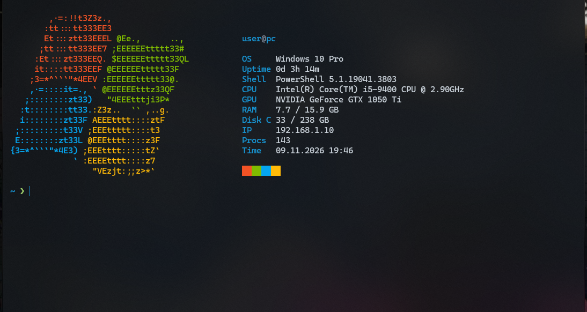
</p>

<p align="center">
  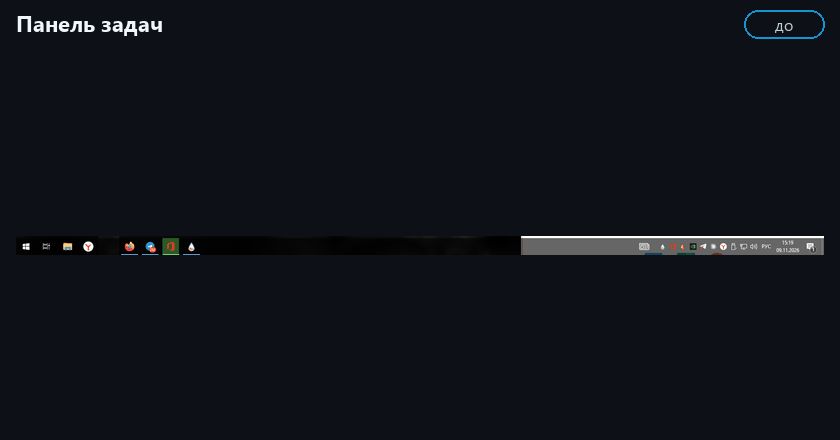<br>
  <sub>前 → 后，逐个场景展示（循环播放）</sub>
</p>

---

## 📑 目录

- [✨ 概览](#-概览)
- [🧱 系统版本与兼容性](#-系统版本与兼容性)
- [🖼 效果对比](#-效果对比)
- [🧩 组件](#-组件)
- [🚀 快速开始](#-快速开始)
- [🧪 安装验证](#-安装验证)
- [❓ 常见问题](#-常见问题)
- [🗂 仓库结构](#-仓库结构)
- [⚠️ 局限性](#️-局限性)
- [♻️ 回滚](#️-回滚)
- [💖 支持](#-支持)

---

## ✨ 概览

开箱即用的 Windows 10 没有 Windows 11 那样的透明和模糊效果：任务栏靠左且不透明，窗口是单调的灰色，控制台看起来像上世纪九十年代。本仓库收集了一组可靠的小工具和设置，在不替换系统外壳的前提下，让系统更接近现代外观。

**你将得到：**

- 🧭 居中的任务栏图标和完全透明的任务栏，关闭“资讯和兴趣”小组件，托盘整洁；
- 🪟 所有窗口的标题栏和边框都带有深色模糊玻璃效果；
- 📁 文件资源管理器内部背景为玻璃质感；
- 🖱 额外的右键菜单项：“结束进程”“关闭无响应的程序”“任务管理器”；
- 🖥 Windows Terminal 作为默认终端：亚克力、自定义配色方案、带系统信息的 Windows 7 启动画面，PowerShell 和 `cmd` 均适用；
- 📊 托盘中的负载指示器：一个 0–100 的数字（内存占用，点击切换为 CPU），悬停提示显示 GB；
- 🔤 Nerd Font 字体，以及带 git 分支、命令耗时和按结果变色的箭头的提示符；
- ⬇️ Quake 终端：按 `Win + ~` 让终端从屏幕顶部以玻璃效果滑出；
- 🎨 全局深色主题和 `#1793D1` 强调色；整洁的开机启动项；
- 🌌 Lively 动态壁纸“Aurora Glass”：同一配色的深色渐变；
- 🔁 全部通过脚本安装，手动步骤有标注，一个脚本即可全部回滚。

**原则：**

- 程序放在 `C:\` 根目录，而不是用户配置文件夹（部分程序无法从后者运行）；
- 每一步相互独立，并单独验证；
- 不破坏任何东西：替换设置前会先复制为 `.bak`；
- 负载极低：总共约 40 MB 内存，CPU 接近 0 %。

## 🧱 系统版本与兼容性

本仓库中的所有内容都在我们的系统版本上构建并测试过。它面向**所有 Windows 10 x64 版本**：包括普通版和精简版（Lite）。

<table width="100%">
  <thead>
    <tr><th align="left">项目</th><th align="left">说明</th></tr>
  </thead>
  <tbody>
    <tr><td>系统</td><td>Windows 10 Pro 22H2，build 19045.3803，x64</td></tr>
    <tr><td>版本</td><td>精简版 <b>Flibustier 制作的 Windows 10 Lite</b></td></tr>
    <tr><td>该版本中已移除</td><td>Windows Defender、Edge、OneDrive、Hyper-V、部分内置应用（计算器、照片、Xbox）以及遥测服务；磁盘占用约 33 GB</td></tr>
    <tr><td>保留的组件</td><td>Microsoft Store（Windows Terminal 由它安装）、文件资源管理器、DWM、PowerShell 5.1</td></tr>
    <tr><td>已验证</td><td>在该版本上，<code>Test-Setup.ps1</code>：26 项全部 OK</td></tr>
  </tbody>
</table>

**这对安装意味着什么：**

- Defender 已被移除，所以系统不会对下载的程序报警，但也没有内置防护：请使用你信任的杀毒软件。
- Microsoft Store 可用，Windows Terminal 由它安装。如果你的 Lite 版本移除了应用商店，请从 [GitHub](https://github.com/microsoft/terminal/releases) 获取 Windows Terminal。
- 该版本没有 Hyper-V，本仓库也不需要它。
- 已停止的搜索、更新和遥测服务不会造成任何问题。
- 在其他 Windows 10 版本上步骤相同。唯一已知的区别：DWMBlurGlass 只内置了 22H2 的符号，其他版本需要在“符号”选项卡中下载（见“常见问题”）。

---

## 🖼 效果对比

### 1. 任务栏

图标居中，任务栏透明，“资讯和兴趣”小组件已关闭。

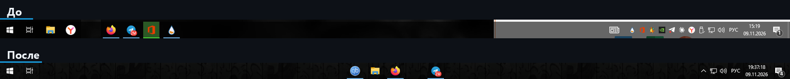

### 2. 通知区域（托盘）

多余的图标收进 `^` 箭头下，只保留系统图标：网络、音量、语言、时钟。

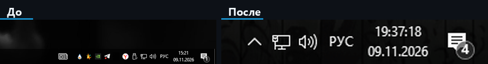

### 3. 文件资源管理器窗口

DWMBlurGlass 让窗口边框和标题栏呈玻璃效果，ExplorerBlurMica 让资源管理器的背景呈玻璃效果。

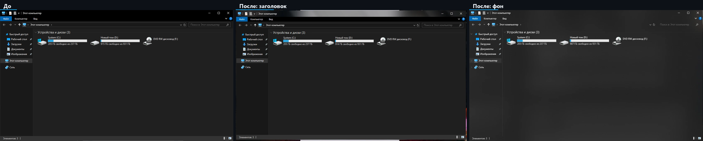

DWMBlurGlass 设置：

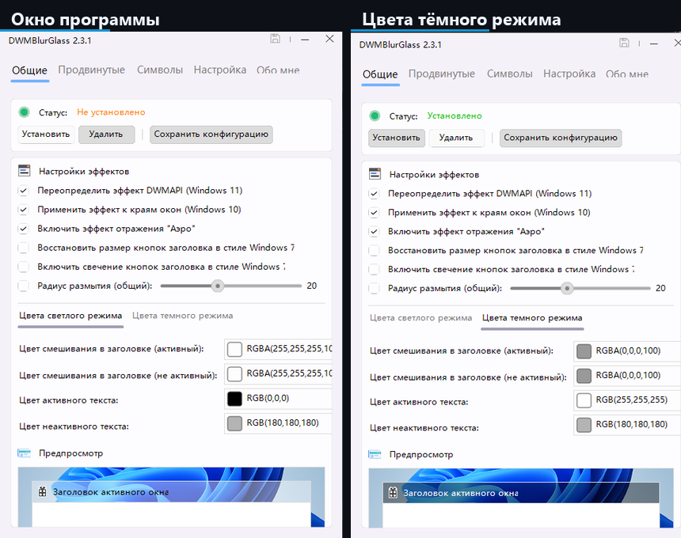

### 4. 终端

默认使用 Windows Terminal，亚克力效果，“Arch Glass”配色方案，带系统信息的 Windows 7 启动画面，彩色提示符。

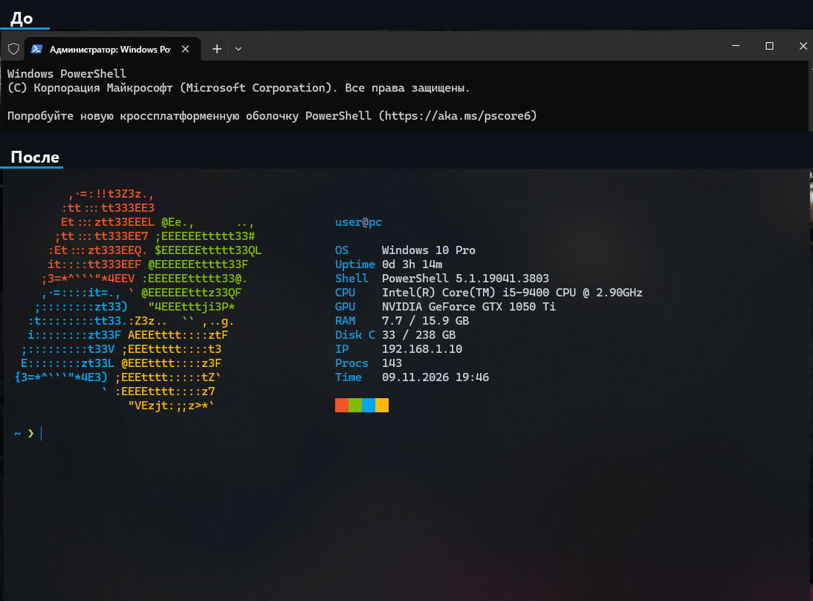

命令提示符（`cmd`）采用相同风格：启动画面、`Shell: Command Prompt`、彩色提示符。

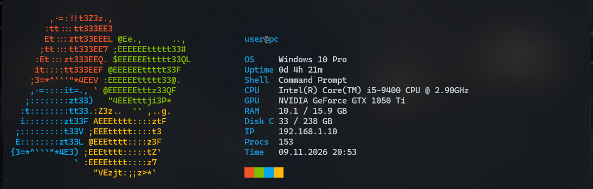

### 5. 右键菜单

额外的菜单项：“结束进程”（用于 `.exe`）、“关闭无响应的程序”、“任务管理器”。

<p align="center">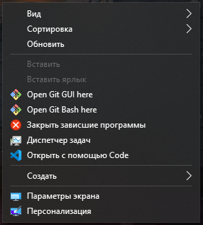</p>

### 6. 任务栏上的鼠标操作

7+ Taskbar Tweaker：中键关闭窗口，滚轮切换窗口，双击打开任务管理器。

<p align="center">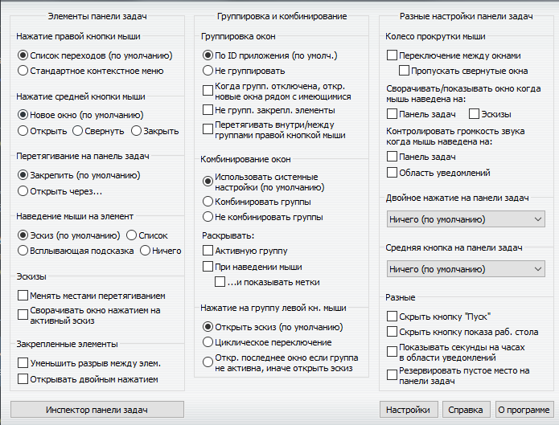</p>

### 7. 托盘中的负载指示器

`^` 箭头旁边的一个大数字：内存占用，范围 0 到 100。悬停提示显示以 GB 为单位的 `RAM` 和 `CPU`。

<p align="center">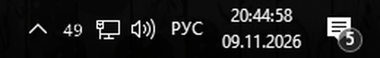</p>

### 8. Quake 终端

按 `Win + ~` 让终端从顶部以玻璃效果滑出，再按一次则隐藏。提示符中会显示 git 分支（Nerd Font 图标）。

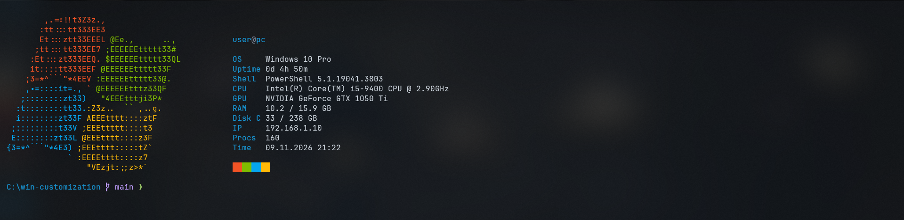

### 9. “Aurora Glass”动态壁纸

为 Lively Wallpaper 制作的原创动态壁纸：深蓝、青绿和紫色渐变光晕缓缓漂移。仅使用 CSS 动画，无脚本，负载极低；全屏应用运行时 Lively 会自动暂停壁纸。


---

## 🧩 组件

点击组件名称可展开详情。

<details>
<summary><b>🧭 TaskbarX</b>：图标居中与透明任务栏</summary>

<br>

[TaskbarX](https://github.com/ChrisAnd1998/TaskbarX) 把任务栏图标移到中间，并可以改变任务栏本身的样式。使用版本 `1.7.8.0`。

**工作原理。** 它在后台运行，每当图标集合发生变化时，平滑地重新计算图标位置。任务栏样式通过启动参数设置。

**使用的参数：**

- `-tbs=1`：透明任务栏（`2` 模糊，`3` 亚克力，`4` 带渐变的透明，`5` 不透明）；
- `-color=0;0;0;0`：任务栏颜色和不透明度，RGBA 格式。

**安装：** `scripts/01-taskbarx.ps1` 将发行版下载到 `C:\TaskbarX`，在真实的“启动”文件夹中创建快捷方式并启动程序。

**注意事项：**

- 每次重启资源管理器时 TaskbarX 都会退出，需要重新启动（脚本 `02` 会自动完成）；
- 不要添加 `-dtbsowm=1`：窗口最大化时任务栏会变成普通的灰色；
- 负载：约 6 MB 内存。

</details>

<details>
<summary><b>🪟 DWMBlurGlass</b>：窗口标题栏和边框的玻璃效果</summary>

<br>

[DWMBlurGlass](https://github.com/Maplespe/DWMBlurGlass) 嵌入桌面窗口管理器（DWM），为所有窗口的标题栏和边框添加模糊和“Aero”反射效果。版本 `2.3.1r`。

**工作原理。** 点击“安装”后，扩展被加载到 DWM 中，其设置（模糊程度、颜色、不透明度）从 `config.ini` 读取。

**关键设置**（`configs/DWMBlurGlass.config.ini`）：

- `blurAmount=35`：模糊强度，数值越大玻璃越“通透”；
- 深色模式颜色 `RGBA(0,0,0,100)`：略带透明的黑色色调；
- 启用 Aero 反射和窗口边缘效果。

**安装：** `scripts/03-dwmblurglass.ps1` 将程序放入 `C:\DWMBlurGlass`。随后手动操作：运行 `DWMBlurGlass.exe`，点击“安装”，保存配置。

**注意事项：**

- 程序拒绝从用户配置文件夹运行，所以只能放在 `C:\...`；
- 如果没有玻璃效果，请在“符号”选项卡中下载 Windows 符号，然后“卸载”并重新“安装”；
- 回滚：程序里的“卸载”按钮。

</details>

<details>
<summary><b>📁 ExplorerBlurMica</b>：文件资源管理器的玻璃背景</summary>

<br>

[ExplorerBlurMica](https://github.com/Maplespe/ExplorerBlurMica) 让文件资源管理器内部的背景变得透明和模糊：文件列表、侧边栏和地址栏。版本 `2.1.0`。

**工作原理。** 它是资源管理器的 COM 扩展，由 `regsvr32` 注册（压缩包中的 `register.cmd` 脚本），之后资源管理器会重启。

**设置**（`configs/ExplorerBlurMica.config.ini`）：

- `effect=2`：普通 Mica；`1` 亚克力，`4` MicaAlt；
- 深色色调：颜色 `0,0,0`，不透明度 `a=120`。

**注意事项：**

- `effect=3`（纯模糊）在窗口打开时会闪烁：窗口先是清晰的，稍后才出现玻璃效果，因此使用 Mica；
- 注册由人工完成（UAC），之后需要重新启动 TaskbarX；
- 回滚：程序文件夹中的 `uninstall.cmd`。

</details>

<details>
<summary><b>🖱 AcrylicMenus 与自定义右键菜单项</b></summary>

<br>

**AcrylicMenus**（[krlvm/AcrylicMenus](https://github.com/krlvm/AcrylicMenus)，`v1.0.8`）为经典的 Win32 右键菜单添加亚克力效果。它还处于实验阶段：在资源管理器和桌面上有效，对自绘菜单（即时通讯软件、Electron）无影响。安装是可选的，`Install.cmd` 由人工运行。

**自定义菜单项**（`scripts/06-context-menu-verbs.ps1`，仅修改 `HKCU`，无需管理员权限）：

| 位置 | 菜单项 | 作用 |
|---|---|---|
| 右键点击 `.exe` | 结束进程 | `taskkill /f /im <name.exe>` |
| 桌面 / 文件夹空白处 | 关闭无响应的程序 | `taskkill /f /fi "status eq not responding"` |
| 桌面 / 文件夹空白处 | 任务管理器 | `taskmgr.exe` |

**回滚：** 删除注册表项 `HKCU\Software\Classes\exefile\shell\EndProcess`，以及 `...\Directory\Background\shell\KillHung` 和 `TaskMgr`（`99-rollback.ps1` 会自动完成）。

</details>

<details>
<summary><b>🛠 7+ Taskbar Tweaker</b>：任务栏上的鼠标操作</summary>

<br>

[7+ Taskbar Tweaker](https://rammichael.com/7-taskbar-tweaker) 改变 Windows 任务栏的响应方式：中键点击、双击或在任务栏上滚动时会发生什么。

**推荐设置：**

- 中键点击图标：“关闭”；
- 在任务栏上滚动滚轮：切换窗口；
- 双击空白处：“任务管理器”；
- 右键点击图标：保持“跳转列表”。

**安装：** `scripts/07-taskbar-tweaker.ps1` 将安装程序下载到 `C:\7TaskbarTweaker`，并**验证其数字签名**（发布者 Michael Maltsev）。签名无效时文件会被删除。安装程序本身由人工运行。

</details>

<details>
<summary><b>🖥 Windows Terminal</b>：亚克力、“Arch Glass”配色、玻璃标签栏</summary>

<br>

Windows Terminal 从 Microsoft Store 安装，并成为默认终端（`scripts/08-console-defaults.ps1`），因此 `cmd`、PowerShell 以及其他程序的控制台都会在它里面打开。

**已配置内容**（`configs/windows-terminal.settings.json`）：

- 亚克力：`useAcrylic=true`，不透明度 `opacity=72`；
- Cascadia Code 12 字体、内边距、竖线光标、无滚动条；
- “Arch Glass”配色方案：背景 `#0b0f14`，强调色 `#1793d1`；
- 玻璃标签栏：`#12171dB8`，失去焦点的窗口略深；
- `cmd` 配置文件带彩色提示符，没有灰色的微软横幅。

**陷阱：**

- 配色方案只接受 `#rrggbb` 格式，`selectionBackground` 中带透明度会导致整个文件加载失败；
- 完全透明的标签栏会让窗口按钮在失去焦点时消失，所以保留了约 70 % 的不透明度。

</details>

<details>
<summary><b>✨ PowerShell 配置文件与 cmd</b>：Windows 7 启动画面</summary>

<br>

启动画面位于单独的文件 `configs/Show-Splash.ps1` 中，由 PowerShell 配置文件（`configs/Microsoft.PowerShell_profile.ps1`）和 `cmd`（`configs/cmd-autorun.cmd`）共同调用。启动时它会打印彩色的 Windows 7 标志和系统信息：用户、系统、运行时间、Shell、CPU、GPU、内存、磁盘、IP、进程数、时间。提示符很简短：蓝色路径（主文件夹显示为 `~`，过长的路径缩短为 `…\最后\三个\文件夹`）和绿色的 `❯` 箭头。

**快速启动的实现方式：**

- 静态数据（系统、CPU、GPU）缓存 7 天，因此很少执行耗时的 WMI 查询；
- 其余数据不使用 WMI 计算，约 75 毫秒；
- 启动画面只在交互式控制台中显示，脚本和被重定向的输出中不会出现；
- 关闭方法：`$env:NO_SPLASH=1`。

**美化 `cmd`。** `configs/cmd-autorun.cmd` 通过 `HKCU\Software\Microsoft\Command Processor\AutoRun` 挂接，对任何普通的交互式 `cmd`（来自终端、`Win + R`、开始菜单）生效：启用 UTF-8，设置彩色提示符（路径单独一行，箭头 `❯` 在下一行），并调用同一个启动画面（`Shell: Command Prompt`）。对于其他程序启动的 `cmd /c ...` 和 `cmd /k ...`，它**不会运行**：启动类型通过延迟扩展读取 `%cmdcmdline%` 判断，所以外来命令中的特殊字符 `& | ! % "` 不会破坏任何东西。如果文件被删除，`cmd` 不会报错（`AutoRun` 中有 `if exist` 检查）。

**截图演示模式。** 配置文件旁的 `splash-demo.json` 文件会把姓名、主机名和 IP 替换为中性值，方便制作公开截图。

</details>

<details>
<summary><b>📊 SysMonTray</b>：托盘中的内存和 CPU 负载指示器</summary>

<br>

我自己写的一个小型 PowerShell 脚本（`configs/SysMonTray.ps1`），不需要外部程序。它在通知区域绘制**一个带 0–100 数字的图标**：内存占用。风格极简：白色的大号数字，75 以上变黄，90 以上变红。

**工作原理。** 每 2 秒读取一次处理器负载计数器和内存状态（`GlobalMemoryStatusEx`），用仍能放下的最大字号把数字绘制到 32×32 的图标上，然后更新图标。

**操作方式：**

- **左键点击**：在 RAM ↔ CPU 之间切换显示；
- **悬停**：提示 `RAM: 49/100 (7.8/15.9 GB)` 和 `CPU: 18/100`；
- **右键点击**：“显示 RAM”“显示 CPU”“退出”。

**安装：** `scripts/12-sysmon-tray.ps1` 将脚本复制到 `C:\SysMonTray`，在真实的“启动”文件夹中创建自启动快捷方式，并在隐藏窗口中运行。如果图标被藏在 `^` 箭头下，请把它拖到任务栏上。

**注意事项：**

- Windows 托盘提示最多 63 个字符，所以文字很短（更长的文字会让图标停止更新）；
- 如果残留旧图标的“幽灵”，把鼠标在托盘上移动一下即可；
- 负载：隐藏的 PowerShell 进程约 40 MB 内存，CPU 约 0 %。

</details>

<details>
<summary><b>🔤 Nerd Font 与提示符</b>：git 分支、命令耗时、状态</summary>

<br>

**字体。** [JetBrainsMono Nerd Font](https://github.com/ryanoasis/nerd-fonts)（`v3.5.1`）为当前用户安装（`scripts/13-nerd-font.ps1`），并在 Windows Terminal 中设置为 `JetBrainsMono Nerd Font`。提示符中的图标由它提供。

**PowerShell 提示符**（`configs/Microsoft.PowerShell_profile.ps1`）：

- 路径：主文件夹显示为 `~`，过长的路径缩短为 `…\最后\三个\文件夹`；
- 带 `` 图标的 git 分支（沿目录树向上读取 `.git/HEAD`，不调用 `git.exe`，支持 worktree）；
- 上一条命令耗时超过 0.5 秒时，显示带时钟图标的耗时（`1.3s`、`2m05s`）；
- `❯` 箭头在命令成功后为绿色，出错后为红色；
- 渲染耗时约 3 毫秒。

**PSReadLine。** 采用终端配色的语法高亮，用 ↑/↓ 按前缀搜索历史，`Tab` 菜单补全。存在 PSReadLine 2.1+ 时，会自动启用灰色的历史预测。

**陷阱。** 在这个 Windows 10 版本上，来自 PowerShell Gallery 的较新 PSReadLine 2.3.6 和 2.4.5 会在按第一个键时关闭控制台（退出码 5），即使不使用配置文件也是如此。因此使用内置的 2.0.0，配置文件会自行检查版本。

</details>

<details>
<summary><b>⬇️ Quake 模式</b>：<code>Win + ~</code></summary>

<br>

`configs/windows-terminal.settings.json` 把 `quakeMode` 操作绑定到 `win+sc(41)`（`1` 左边的 `~` 键），并启用 `minimizeToNotificationArea`，让终端保留在托盘中。窗口使用相同的配色和亚克力效果从顶部滑出，再按一次该键则隐藏。

**说明：** 只要 Windows Terminal 在运行（至少最小化到托盘），该快捷键就有效。

</details>

<details>
<summary><b>🎨 深色主题与强调色</b>：<code>#1793D1</code></summary>

<br>

`scripts/14-accent-theme.ps1` 为 Windows 和应用启用深色主题和透明效果，并设置 `#1793D1` 强调色（与终端相同的蓝色）：为开始菜单、链接、开关和选中项提供 7 个色阶的调色板。标题栏不会被着色，保留 DWMBlurGlass 的玻璃效果。原有值保存在 `%USERPROFILE%\accent-backup.json`，`99-rollback.ps1` 会还原它们。

</details>

<details>
<summary><b>🚀 开机启动项</b>：可逆的清理</summary>

<br>

`scripts/15-startup-review.ps1` 列出所有随 Windows 启动的项目，并像“任务管理器 → 禁用”一样禁用所选项目（通过 `StartupApproved`，`Run` 中的条目保持不变）：

```powershell
.\scripts\15-startup-review.ps1 -Disable 'Mozilla-Firefox-*'
.\scripts\15-startup-review.ps1 -Enable  'Mozilla-Firefox-*'
```

请保持美化组件处于启用状态（TaskbarX、SysMonTray、AcrylicMenus、7+ Taskbar Tweaker、Lively）。

</details>

<details>
<summary><b>🌌 Aurora Glass 动态壁纸</b>：Lively Wallpaper</summary>

<br>

我自己制作的网页壁纸（`configs/lively/aurora-glass/`）：四个大型径向渐变采用终端配色，在柔和的暗角和轻微颗粒感下缓缓漂移。只使用 `transform` 动画（GPU 加速），不含 JavaScript；设置 `prefers-reduced-motion` 时动画会关闭。

**安装：** `scripts/16-live-wallpaper.ps1` 生成 `C:\LivelyWallpapers\aurora-glass.zip` 壁纸包，并打开 [Lively Wallpaper](https://github.com/rocksdanister/lively)。随后手动操作：点击 `+` 按钮 → 选择 zip → 点击“Aurora Glass”。

**陷阱：** Lively 2.x 中的 `Lively.exe setwp --file` 无法导入新文件（“Unsupported command import file”），所以需要在程序窗口中导入。

</details>

<details>
<summary><b>🛡 ShellGuard</b>：资源管理器卡死后自动恢复（可选）</summary>

<br>

**发生了什么。** 有时 `explorer.exe` 会卡死，Windows 将其关闭并重新启动（日志中会出现“Application Hang”和“Shell 意外终止”）。所有依附于旧资源管理器的东西都会“失去归属”：TaskbarX 丢失任务栏的居中和透明效果（还可能空转占用 CPU），Lively 丢失桌面背景窗口（`WorkerW`），动态壁纸消失，只剩静态壁纸。

**工作原理。** `configs/ShellGuard.ps1` 每 5 秒比较资源管理器与 TaskbarX、Lively 的启动时间。如果后两者比资源管理器更早启动，守护程序会等待 10 秒，重启 TaskbarX 并完全重启 Lively（在 Lively 2.x 的这种状态下，用 `setwp` 重新应用壁纸无效）。每 90 秒最多一次，所有操作记录在 `C:\ShellGuard\guard.log` 中。

**安装。** `scripts/17-shell-guard.ps1`（包含在 `Install-Auto.ps1` 中）：将脚本复制到 `C:\ShellGuard`，添加自启动快捷方式，并在隐藏窗口中启动。

- 不做任何更改地查看状态：`powershell -File C:\ShellGuard\ShellGuard.ps1 -Check`；
- 强制修复：`-RepairNow`。

**注意事项：** 约 40 MB 内存，CPU 约 0 %；回滚：`scripts/99-rollback.ps1`。它处理的是后果，而不是卡死的原因：如果资源管理器经常卡死，请尝试禁用可选扩展（AcrylicMenus、ExplorerBlurMica）。

</details>
<details>
<summary><b>🎨 壁纸</b>：深色 4K 渐变</summary>

<br>

`scripts/11-wallpaper.ps1` 从 [Wallhaven](https://wallhaven.cc) 下载两张体积很小的深色 4K 壁纸（约 0.4 MB 和 0.6 MB）到 `C:\Wallpapers`，并设置第一张。深色渐变最能衬托透明任务栏和玻璃窗口。

</details>

---

## 🚀 快速开始

**一条命令**（PowerShell；会自动请求管理员权限、下载缺失的组件、按顺序安装并在最后输出汇总与自检）：

```powershell
[Net.ServicePointManager]::SecurityProtocol = 'Tls12'; irm https://raw.githubusercontent.com/swensi17/win-customization/main/Install.ps1 | iex
```

在 cmd 或“运行”（Win+R）中：

```bat
powershell -NoProfile -ExecutionPolicy Bypass -Command "[Net.ServicePointManager]::SecurityProtocol='Tls12'; irm https://raw.githubusercontent.com/swensi17/win-customization/main/Install.ps1 | iex"
```

安装器会自动处理：

- 从 pwsh 或 32 位终端启动时切换到 64 位 Windows PowerShell 5.1；
- 请求管理员权限，并确认与当前登录的用户一致；
- 安装缺失的 Visual C++ x64、WebView2 和 Windows Terminal（系统无法安装应用时使用便携版）；
- 带重试与备用通道下载（curl、BITS、绕过 GitHub API 限制），校验安装包签名与 SHA-256；
- 托盘程序以普通权限启动，与正常登录时相同；
- 单个步骤失败时继续执行，最后输出汇总与自检。

可以重复运行。只重试某些步骤：`.\scripts\Install-Auto.ps1 -Only 09,16`。只有一步需要手动，且仅在首次安装时：在 DWMBlurGlass 窗口中点击“安装”。日志：`%TEMP%\win-customization-install.log`。

或分步安装：

1. 下载本仓库并解压，例如解压到 `C:\win-customization`。
2. 在 `scripts` 文件夹中打开 PowerShell：

```powershell
Set-ExecutionPolicy -Scope Process Bypass
.\Install-Auto.ps1
```

3. 遇到标有 `MANUAL` 的步骤时，按提示操作（运行安装程序、注册、UAC），然后按 Enter。
4. 对照 [playbook](docs/AGENT_PLAYBOOK.md) 第 5 节的检查清单确认结果（俄语）。

**环境要求：** Windows 10 x64（任何版本，包括 Lite；已在 22H2、build 19045 上验证）；来自 Microsoft Store 的 Windows Terminal；可访问 GitHub 以下载发行版。

---

## 🧪 安装验证

安装完成后运行自检脚本。它不会更改任何内容，并对每一项输出 `OK`、`FAIL` 或 `skip`：

```powershell
.\scripts\Test-Setup.ps1
```

它会检查：TaskbarX 是否运行并已自启动、托盘是否已折叠、“资讯和兴趣”是否关闭、DWMBlurGlass 和 ExplorerBlurMica 是否已加载、右键菜单项是否存在、Windows Terminal 是否为默认终端、“Arch Glass”配色方案、PowerShell 配置文件和 cmd 美化是否生效，以及字体、主题、Quake 模式等。

```text
== 任务栏与托盘 ==
[ OK ] TaskbarX 正在运行
[ OK ] TaskbarX 已自启动（Startup 快捷方式）
[ OK ] 托盘已折叠（EnableAutoTray = 1）
...
合计：26 OK，0 FAIL，0 跳过
```

退出码等于 `FAIL` 的数量，因此该脚本很适合用于自动化。可选组件（AcrylicMenus、7+ Taskbar Tweaker、没有管理员权限时的 DWM 检查）缺失时会标记为 `skip`。

---

## ❓ 常见问题

<details>
<summary><b>🪟 窗口标题栏没有玻璃效果</b></summary>

<br>

1. 确认 DWMBlurGlass 位于 `C:\DWMBlurGlass`，而不是用户配置文件夹：从后者无法启动。
2. 打开程序，在“符号”选项卡中下载 Windows 符号。
3. 依次点击“卸载”“安装”“保存配置”。
4. 关闭并重新打开资源管理器窗口。

</details>

<details>
<summary><b>🧭 任务栏恢复成原样，图标跑到了左边</b></summary>

<br>

每次重启资源管理器时 TaskbarX 都会退出（`register.cmd`、安装 ExplorerBlurMica 和脚本 `02` 都会重启它）。重新启动即可：

```powershell
& "C:\TaskbarX\TaskbarX.exe" -tbs=1 -color=0;0;0;0
```

如果重启电脑后它没有自动启动，请检查 `TaskbarX.lnk` 是否在 `shell:startup` 中，并重新运行 `scripts/01-taskbarx.ps1`。

</details>

<details>
<summary><b>🖥 终端提示“无法加载设置”</b></summary>

<br>

`settings.json` 中有错误。最常见的原因是配色方案里带透明度的颜色（只允许 `#rrggbb`）或多余的逗号。还原文件旁边的备份：

```powershell
$d = "$env:LOCALAPPDATA\Packages\Microsoft.WindowsTerminal_8wekyb3d8bbwe\LocalState"
Copy-Item "$d\settings.json.bak" "$d\settings.json" -Force
```

或者重新复制 `configs/windows-terminal.settings.json`（步骤 `09`）。

</details>

<details>
<summary><b>📂 提示“位置不可用”或看不到文件</b></summary>

<br>

如果安装由打包（Microsoft Store）应用执行，写入 `%LOCALAPPDATA%` 和 `%APPDATA%` 的内容会进入该应用的隔离文件夹，资源管理器看不到它们。解决办法：把程序放在 `C:\...`，并把自启动快捷方式放在真实路径 `...\Roaming\Microsoft\Windows\Start Menu\Programs\Startup`。

</details>

<details>
<summary><b>✨ 资源管理器窗口打开时闪烁</b></summary>

<br>

`C:\ExplorerBlurMica\Release\config.ini` 中是 `effect=3`（纯模糊）。改回 `effect=2`（Mica）并重启资源管理器。

</details>

<details>
<summary><b>⚙️ 启动画面不显示或很慢</b></summary>

<br>

- 不显示：检查 `Get-ExecutionPolicy -List`，`LocalMachine` 必须是 `RemoteSigned` 或更宽松；确认没有设置 `NO_SPLASH`；
- 第一次运行很慢：数据缓存只构建一次，之后就很快；
- 完全关闭：`$env:NO_SPLASH=1` 或删除 `$PROFILE` 文件。

</details>

<details>
<summary><b>🔲 窗口最大化时任务栏变成灰色</b></summary>

<br>

TaskbarX 的启动参数中残留了 `-dtbsowm=1`。删除它：正确的参数是 `-tbs=1 -color=0;0;0;0`。

</details>

---

## 🗂 仓库结构

<table width="100%">
  <thead>
    <tr><th align="left">路径</th><th align="left">用途<br></th></tr>
  </thead>
  <tbody>
    <tr><td><a href="docs/AGENT_PLAYBOOK.md"><code>docs/AGENT_PLAYBOOK.md</code></a></td><td>带有 <code>AUTO</code> / <code>MANUAL</code> / <code>VERIFY</code> / <code>ROLLBACK</code> / <code>WARN</code> 标签的分步说明（俄语）</td></tr>
    <tr><td><code>scripts/</code></td><td>分步脚本 <code>00</code>…<code>17</code>，回滚脚本 <code>99-rollback.ps1</code>，一键安装脚本 <code>Install-Auto.ps1</code></td></tr>
    <tr><td><code>scripts/Test-Setup.ps1</code></td><td>验证安装结果（每项 OK / FAIL）</td></tr>
    <tr><td><code>configs/</code></td><td>现成的配置：Windows Terminal、PowerShell 配置文件、DWMBlurGlass、ExplorerBlurMica、Lively 动态壁纸</td></tr>
    <tr><td><code>screenshots/</code></td><td>前后对比截图、演示 gif</td></tr>
    <tr><td><code>docs/social-preview.png</code></td><td>社交网络中链接预览使用的图片</td></tr>
    <tr><td><a href="CONTRIBUTING.md"><code>CONTRIBUTING.md</code></a>、<a href="CHANGELOG.md"><code>CHANGELOG.md</code></a></td><td>贡献规则和版本历史</td></tr>
  </tbody>
</table>

---

## ⚠️ 局限性

- 玻璃效果只作用于窗口标题栏和边框、文件资源管理器以及经典菜单。“设置”窗口、应用商店、浏览器和许多即时通讯软件自己绘制背景，因此不会变成玻璃效果。
- 部分组件会嵌入系统进程。请自行承担安装风险，回滚方法见下文。
- 面向所有 Windows 10 x64 版本。已在 22H2（build 19045）上完整验证，包括 Flibustier 制作的精简版 Windows 10 Lite。在其他版本上请运行 `Test-Setup.ps1` 并查看
- 所有第三方程序归其作者所有，来源链接见“组件”一节。
- 语言按钮上的旗帜来自 [flag-icons](https://github.com/lipis/flag-icons)（MIT 许可证）。

---

## ♻️ 回滚

```powershell
.\scripts\99-rollback.ps1
```

手动安装的组件按常规方式卸载：DWMBlurGlass（“卸载”）、ExplorerBlurMica 和 AcrylicMenus 的 `uninstall.cmd`、7+ Taskbar Tweaker 的卸载程序。然后删除 `C:\` 中的文件夹。

---

## 💖 支持

如果本仓库对你有帮助，欢迎支持我的工作。这完全是自愿的，但我始终心怀感激。

<p>
  <a href="https://t.me/tribute/app?startapp=ep_7qdvBb34zk7b1QW4bCTfA7YXRfpCz2PJoV25omHd06QXD9Lw7d">
    
  </a>
  <a href="https://github.com/swensi17/win-customization">
    
  </a>
</p>

谢谢！💖

---

<p align="center">
  
</p>

<p align="center">
  <code>© 2026-present <a href="https://github.com/swensi17">swensi17</a></code>
</p>

<p align="center">
  <a href="LICENSE"></a>
</p>
