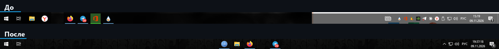
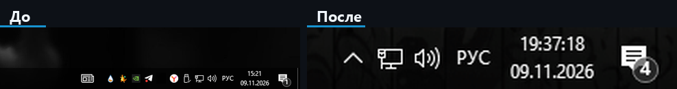
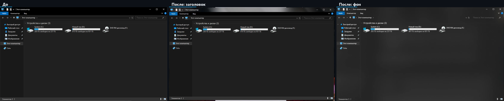
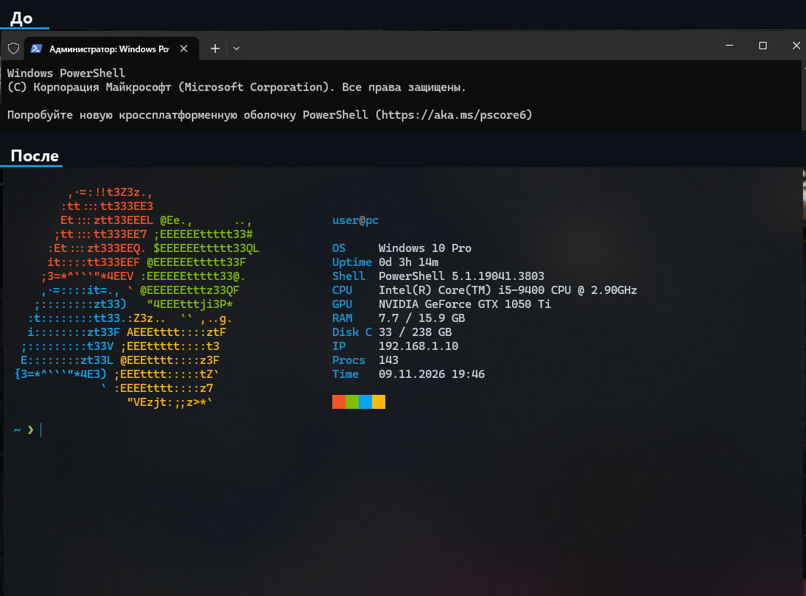
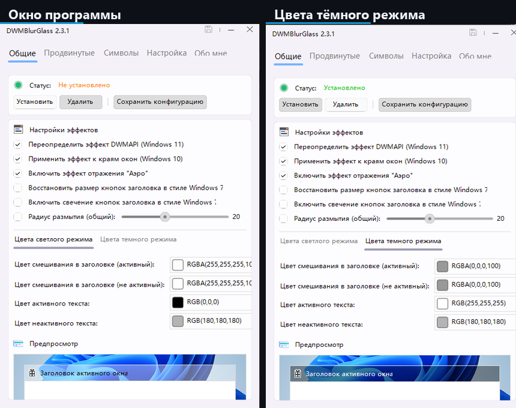
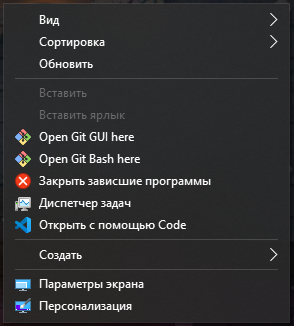
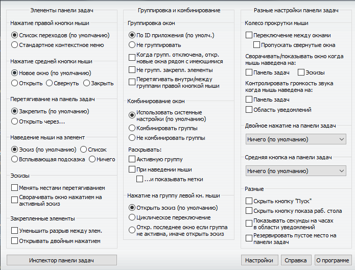
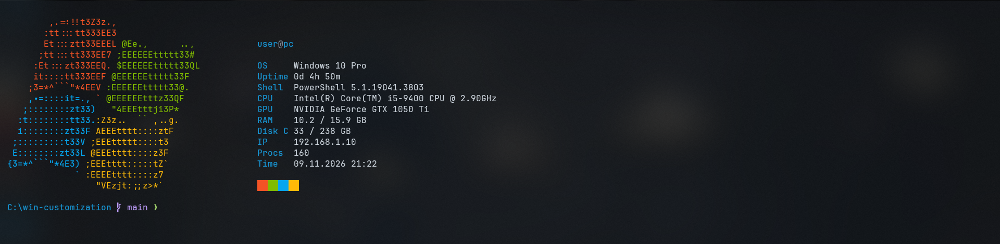
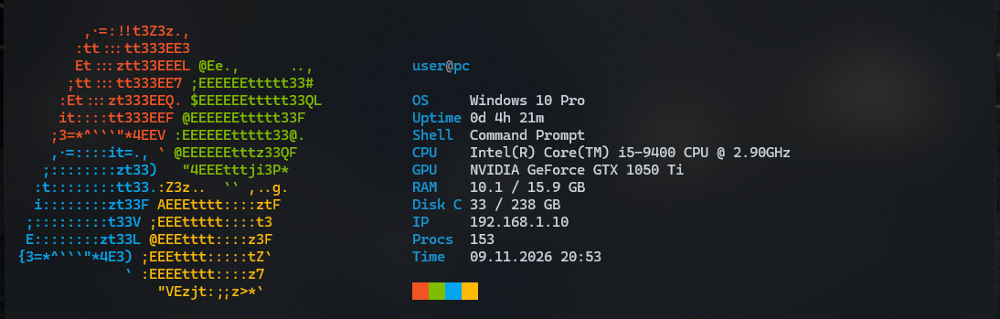
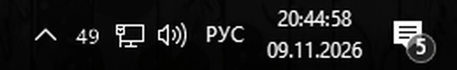

# Playbook: оформление Windows 10 в стиле «жидкое стекло»

> Документ для исполнителя (человек или агент). Цель: на чистой Windows 10 получить тот же результат, что на скриншотах ниже.
> Следуй шагам по порядку. После каждого шага выполни блок **VERIFY**. Любой шаг откатывается блоком **ROLLBACK**.

## 0. Теги

<table width="100%">
  <thead>
    <tr><th align="left">Тег</th><th align="left">Значение </th></tr>
  </thead>
  <tbody>
    <tr><td><code>[AUTO]</code></td><td>Выполняется скриптом без участия пользователя.</td></tr>
    <tr><td><code>[MANUAL]</code></td><td>Делает человек (двойной клик, UAC, GUI). Агент только готовит файлы и объясняет шаг.</td></tr>
    <tr><td><code>[VERIFY]</code></td><td>Проверка, что шаг сработал.</td></tr>
    <tr><td><code>[ROLLBACK]</code></td><td>Как вернуть как было.</td></tr>
    <tr><td><code>[WARN]</code></td><td>Известная ловушка, читать до выполнения.</td></tr>
  </tbody>
</table>

## 1. Целевая система и результат

- Windows 10 Pro 22H2, build 19045, x64; облегчённая сборка Windows 10 Lite от Flibustier (вырезаны Defender, Edge, OneDrive, Hyper-V). Репозиторий рассчитан на все версии Windows 10 x64, проверен на этой сборке.
- Права: обычный пользователь для большинства шагов, UAC для G[MANUAL]G-шагов регистрации.
- Рабочие каталоги: все сторонние программы лежат **в корне диска C:\** (причина в разделе 4).

Результат:

<table width="100%">
  <thead>
    <tr><th align="left">Что</th><th align="left">Как выглядит </th></tr>
  </thead>
  <tbody>
    <tr><td>Панель задач</td><td>Иконки по центру, панель полностью прозрачная, трей свёрнут в <code>^</code>, «Новости» выключены</td></tr>
    <tr><td>Заголовки и рамки окон</td><td>Размытое тёмное стекло во всех окнах</td></tr>
    <tr><td>Фон Проводника</td><td>Mica/стекло внутри окна</td></tr>
    <tr><td>Меню ПКМ</td><td>Свои пункты («Завершить процесс», «Закрыть зависшие программы», «Диспетчер задач»); акрил в меню через AcrylicMenus (по желанию)</td></tr>
    <tr><td>Терминал</td><td>Windows Terminal по умолчанию, акрил, схема «Arch Glass», заставка с логотипом Windows 7</td></tr>
  </tbody>
</table>

### Эталонные кадры

Панель задач:

Трей:

Проводник:

Терминал:

## 2. Компоненты

<table width="100%">
  <thead>
    <tr><th align="left">Компонент</th><th align="left">Версия</th><th align="left">Источник</th><th align="left">Путь</th><th align="left">Автозапуск </th></tr>
  </thead>
  <tbody>
    <tr><td>TaskbarX</td><td>1.7.8.0</td><td>github.com/ChrisAnd1998/TaskbarX</td><td><code>C:\TaskbarX</code></td><td>ярлык в <code>shell:startup</code></td></tr>
    <tr><td>DWMBlurGlass</td><td>2.3.1r</td><td>github.com/Maplespe/DWMBlurGlass</td><td><code>C:\DWMBlurGlass</code></td><td>встроен в DWM после «Установить»</td></tr>
    <tr><td>ExplorerBlurMica</td><td>2.1.0</td><td>github.com/Maplespe/ExplorerBlurMica</td><td><code>C:\ExplorerBlurMica\Release</code></td><td>COM-расширение Проводника</td></tr>
    <tr><td>AcrylicMenus</td><td>v1.0.8</td><td>github.com/krlvm/AcrylicMenus</td><td><code>%LocalAppData%\AcrylicMenus</code></td><td><code>HKCU\...\Run</code> (ставит <code>Install.cmd</code>)</td></tr>
    <tr><td>7+ Taskbar Tweaker</td><td>текущая</td><td>rammichael.com (подпись: Michael Maltsev)</td><td><code>C:\7TaskbarTweaker</code></td><td>ставит установщик</td></tr>
    <tr><td>Windows Terminal</td><td>1.24+</td><td>Microsoft Store <code>9N0DX20HK701</code></td><td>Store</td><td>н/д</td></tr>
  </tbody>
</table>

Нагрузка (замер): суммарно около 40 МБ ОЗУ, процессор около 0 %.

## 3. Порядок выполнения

Быстрый путь: Girm https://raw.githubusercontent.com/swensi17/win-customization/main/Install.ps1 | iexG (или Gscripts\Install-Auto.ps1G): переходит в 64-битный PowerShell 5.1, сам просит админа и сверяет пользователя, ставит Visual C++ x64, WebView2 и Windows Terminal, затем всё по порядку (04, 05, 07, 16 без ручных действий), не падает на одной ошибке, в конце печатает итог и запускает Test-Setup. Общие функции (загрузка с повтором, обход лимита GitHub API, проверка подписи и SHA-256, запуск без админа, перезапуск Проводника) лежат в Gscripts\lib\Common.ps1G. Вручную остаётся только кнопка «Установить» в DWMBlurGlass и только при первой установке (WARN: у программы нет командной строки; флаг G-SkipManualG пропускает ожидание). WARN: GInstall.ps1G держать только в ASCII и без BOM, иначе Girm | iexG падает; остальные G.ps1G наоборот в UTF-8 с BOM, иначе PowerShell 5.1 портит кириллицу. Подробно по шагам:

### Шаг 0. Проверка окружения G[AUTO]G
Gscripts\00-prereqs.ps1G
- G[VERIFY]G build ≥ 19041, Windows Terminal установлен, политика GLocalMachineG не GRestrictedG/GAllSignedG (иначе профиль PowerShell не загрузится).

### Шаг 1. TaskbarX: центр + прозрачность G[AUTO]G
Gscripts\01-taskbarx.ps1G. Аргументы запуска: G-tbs=1 -color=0;0;0;0G.
- G-tbsG: 1 = прозрачная, 2 = блюр, 3 = акрил, 4 = прозрачная с градиентом, 5 = непрозрачная, 0 = выкл.
- Не добавлять G-dtbsowm=1G: он возвращает обычную панель, когда окно развёрнуто (получается серая панель).
- G[VERIFY]G GGet-Process TaskbarXG; иконки по центру; ярлык лежит в G[Environment]::GetFolderPath('Startup')G.
- G[ROLLBACK]G Gscripts\99-rollback.ps1G.

### Шаг 2. Трей и «Новости» G[AUTO]G
Gscripts\02-tray-and-news.ps1G
- GHKCU\...\Feeds\ShellFeedsTaskbarViewMode = 2G (Новости выкл).
- GHKCU\...\Explorer\EnableAutoTray = 1G (все значки уходят под G^G, системные остаются).
- Затем перезапускается Проводник. G[WARN]G Это закрывает TaskbarX, скрипт запускает его снова.
- G[MANUAL]G Нужные значки (мессенджеры и т.п.) пользователь перетаскивает из G^G на панель сам.
- G[VERIFY]G газеты нет, в трее только системные значки и стрелка.

### Шаг 3. DWMBlurGlass: стекло на рамках всех окон G[AUTO + MANUAL]G
Gscripts\03-dwmblurglass.ps1G скачивает в GC:\DWMBlurGlassG и кладёт готовый Gconfig.iniG.
- G[WARN]G Программа выдаёт «приложение должно быть запущено вне папки пользователя». Только GC:\...G.
- G[MANUAL]G Запустить GDWMBlurGlass.exeG → **Установить** (статус «Установлено») → вкладка «Цвета тёмного режима»: GRGBA(0,0,0,100)G для активного и неактивного заголовка → **Сохранить конфигурацию**.
- Если эффект не виден: вкладка «Символы» → скачать символы, затем «Удалить» → «Установить».
- Ключевые значения конфига (Gconfigs\DWMBlurGlass.config.iniG): GblurAmount=35G, GactiveBlendColorDark=1677721600G (чёрный, прозрачность около 100/255), Greflection=trueG.

- G[VERIFY]G открыть Проводник: заголовок размытый и полупрозрачный.
- G[ROLLBACK]G в программе кнопка «Удалить».

### Шаг 4. ExplorerBlurMica: фон Проводника G[AUTO + MANUAL]G
Gscripts\04-explorerblurmica.ps1G разворачивает GC:\ExplorerBlurMica\ReleaseG и кладёт Gconfig.iniG.
- G[MANUAL]G Запустить Gregister.cmdG (UAC). Он вызывает Gregsvr32G и перезапускает Проводник.
- Конфиг: Geffect=2G (Mica), тёмный цвет G0,0,0G с Ga=120G.
- G[WARN]G Geffect=3G (чистый блюр) даёт неприятное «моргание» при открытии окна: окно сначала резкое, потом включается стекло. Оставлять Geffect=2G.
- После регистрации перезапустить TaskbarX (Проводник его убил).
- G[VERIFY]G фон списка файлов в Проводнике тёмный и полупрозрачный.
- G[ROLLBACK]G Guninstall.cmdG в той же папке.

### Шаг 5. AcrylicMenus: акрил в меню ПКМ G[AUTO + MANUAL]G
Gscripts\05-acrylicmenus.ps1G → G[MANUAL]G GC:\AcrylicMenus\Installer\Install.cmdG (не GInstallAllUsersG).
- Установщик копирует файлы в G%LocalAppData%\AcrylicMenusG, пишет автозапуск и стартует GAcrylicMenusLoader.exeG.
- G[WARN]G Проект экспериментальный. Работает с классическими меню Win32 (Проводник, рабочий стол), нестандартные меню (Telegram, Electron) не затрагивает.
- G[VERIFY]G ПКМ по рабочему столу: меню размытое и полупрозрачное.
- G[ROLLBACK]G GInstaller\Uninstall.cmdG.

### Шаг 6. Свои пункты в меню ПКМ G[AUTO]G
Gscripts\06-context-menu-verbs.ps1G (только GHKCUG, без администратора).

<table width="100%">
  <thead>
    <tr><th align="left">Где</th><th align="left">Пункт</th><th align="left">Команда </th></tr>
  </thead>
  <tbody>
    <tr><td>ПКМ по <code>.exe</code></td><td>Завершить процесс</td><td><code>cmd /c for %I in ("%1") do taskkill /f /im "%~nxI"</code></td></tr>
    <tr><td>Фон рабочего стола/папки</td><td>Закрыть зависшие программы</td><td><code>taskkill /f /fi "status eq not responding"</code></td></tr>
    <tr><td>Фон рабочего стола/папки</td><td>Диспетчер задач</td><td><code>taskmgr.exe</code></td></tr>
  </tbody>
</table>

- G[VERIFY]G пункты видны в меню (при необходимости перезапустить Проводник).

### Шаг 7. 7+ Taskbar Tweaker G[AUTO + MANUAL]G
Gscripts\07-taskbar-tweaker.ps1G скачивает установщик и **проверяет цифровую подпись** (должна быть GValidG, издатель Michael Maltsev); при невалидной подписи файл удаляется.
- G[MANUAL]G Запустить установщик, включить автозапуск. Рекомендуемые настройки:
  - Нажатие средней кнопки мыши по значку: **Закрыть**.
  - Колесо мыши над панелью: **переключение между окнами**.
  - Двойное нажатие на панели задач: **Диспетчер задач**.
  - Правая кнопка по значку: оставить «Список переходов».

### Шаг 8. Консоль и терминал по умолчанию G[AUTO]G
Gscripts\08-console-defaults.ps1G
- Старая консоль (GHKCU\ConsoleG): прозрачность 215/255, Consolas 18 px, мягкая цветовая таблица, 120×30.
- Терминал по умолчанию: GHKCU\Console\%%StartupG: GDelegationConsole={2EACA947-7F5F-4CFA-BA87-8F7FBEEFBE69}G, GDelegationTerminal={E12CFF52-A866-4C77-9A90-F570A7AA2C6B}G.
- G[WARN]G Ключ называется буквально G%%StartupG; в PowerShell обращаться через G-LiteralPathG.
- G[VERIFY]G GWin+RG → GcmdG открывается в Windows Terminal.

### Шаг 9. Windows Terminal: тема «Arch Glass» G[AUTO]G
Gscripts\09-windows-terminal.ps1G копирует Gconfigs\windows-terminal.settings.jsonG в
G%LOCALAPPDATA%\Packages\Microsoft.WindowsTerminal_8wekyb3d8bbwe\LocalState\settings.jsonG (с бэкапом).

Ключевые параметры:
- Профиль по умолчанию: Windows PowerShell, команда Gpowershell.exe -NoLogoG.
- Профиль cmd: Gcmd.exe /k "cls & prompt $E[38;2;23;147;209m$P$E[0m $E[38;2;158;206;106m❯$E[0m$S"G.
- Gprofiles.defaultsG: шрифт Cascadia Code 12, Gopacity=72G, GuseAcrylic=trueG, отступы G14,10,14,10G, курсор-палка, без полосы прокрутки.
- Схема «Arch Glass»: фон G#0b0f14G, текст G#c9d1d9G, акцент G#1793d1G.
- Тема окна «Arch Glass UI»: строка вкладок со стеклом: GtabRow.background=#12171dB8G, GunfocusedBackground=#12171dA0G, GuseAcrylicInTabRow=trueG.

G[WARN]G Ловушки конфига:
- В GschemesG цвета только G#rrggbbG. Прозрачность в GselectionBackgroundG (например, G#1793d155G) ломает загрузку всего файла («Не удалось загрузить параметры»).
- Полностью прозрачная строка вкладок (G...00G) даёт «пропадающие» кнопки окна при потере фокуса и вид «как будто нет фона». Нужен оттенок с непрозрачностью около 60–70 %.
- Шрифт: GJetBrainsMono Nerd FontG (шаг 13), запасной Cascadia Code встроен в Windows Terminal.
- Quake-режим: действие GquakeModeG на Gwin+sc(41)G (GWin + ~G) и GminimizeToNotificationArea=trueG; горячая клавиша работает, пока процесс Windows Terminal запущен.

### Шаг 10. Профиль PowerShell и cmd: логотип Windows 7 G[AUTO]G
Gscripts\10-powershell-profile.ps1G кладёт в папку профиля GMicrosoft.PowerShell_profile.ps1G, общую заставку GShow-Splash.ps1G и оформление cmd Gcmd-autorun.cmdG (из Gconfigs\G), а также прописывает GAutoRunG для cmd.

Что делает профиль:
- Заставка: цветной логотип Windows 7 (ASCII, 4 цвета) + информация: пользователь@хост, ОС, аптайм, оболочка, CPU, GPU, RAM, диск C, IP, число процессов, время.
- Приглашение: голубой путь (G~G для домашней папки, длинные пути сокращаются до G…\последние\три\папкиG) + зелёная стрелка G❯G. В cmd путь выводится отдельной строкой (G$_G в GpromptG), стрелка ниже.
- Быстрый старт: статичные данные (ОС/CPU/GPU) кэшируются в G%LOCALAPPDATA%\splash-cache.jsonG на 7 дней, остальное считается без WMI (около 75 мс).
- Демо-режим для публичных скриншотов: файл Gsplash-demo.jsonG рядом с профилем (G{"user":"user","host":"pc","ip":"192.168.1.10"}G) подменяет имя, хост и IP на нейтральные. Удали файл, чтобы вернуть реальные значения.
- Заставка включается только в интерактивной консоли (G-not [Console]::IsOutputRedirectedG), поэтому скрипты и инструменты её не видят. Отключить вручную: G$env:NO_SPLASH=1G.

- **cmd.** Скрипт Gcmd-autorun.cmdG прописывается в GHKCU\Software\Microsoft\Command Processor\AutoRunG значением Gif exist "<путь>\cmd-autorun.cmd" call "<путь>\cmd-autorun.cmd"G. Он включает Gchcp 65001G, ставит цветное приглашение и вызывает GShow-Splash.ps1 -ShellName "Command Prompt"G. Профиль «Командная строка» в Windows Terminal оставлен обычным Gcmd.exeG.
- G[WARN]G AutoRun выполняется при **каждом** запуске cmd, в том числе Gcmd /cG из других программ. Поэтому скрипт обязан сразу выходить для неинтерактивных запусков: проверять G%cmdcmdline%G только через отложенное раскрытие (Gsetlocal EnableDelayedExpansionG, G!cmdcmdline!G), иначе символы G& | ! % "G в чужой команде ломают разбор.
- G[WARN]G Для запуска из терминала GcmdcmdlineG равна Gcmd.exe G (без ключей), хвост после Gcmd.exeG бывает пустым. Подстановка кавычек на пустой переменной даёт мусор, поэтому к хвосту дописывается символ GxG, и сравнивать нужно с GxG.
- G[VERIFY]G Gcmd /c "echo a & echo b | find \"b\""G даёт тот же вывод, что с отключённым автозапуском (Gcmd /d /c ...G); новая вкладка Gcmd.exeG показывает заставку.

G[WARN]G Выравнивание: каждая строка логотипа дополняется пробелами до видимой ширины 46 символов. Если ширина строк логотипа меняется, поправь число 46 в цикле вывода.
G[WARN]G В PowerShell запятая в массиве имеет приоритет над G+G: G"a" + "b",G ломает элементы массива. Склеивай строки внутри одной пары кавычек.

- G[VERIFY]G новая вкладка PowerShell показывает логотип и ровный столбец данных.
- G[ROLLBACK]G вернуть GMicrosoft.PowerShell_profile.ps1.bakG.

### Шаг 11. Обои G[AUTO]G
Gscripts\11-wallpaper.ps1G (Wallhaven, SFW, тёмные градиенты 4K, около 0,4 и 0,6 МБ) → GC:\WallpapersG.

### Шаг 12. SysMonTray: индикатор нагрузки в трее G[AUTO]G
Gscripts\12-sysmon-tray.ps1G копирует Gconfigs\SysMonTray.ps1G в GC:\SysMonTrayG, создаёт ярлык автозапуска в **настоящей** папке Startup и запускает скрипт скрытым окном (Gpowershell.exe -NoProfile -STA -WindowStyle Hidden -File ...G).
- Поведение: один значок с числом 0–100 (заполнение RAM, цифры белые, жёлтые от 75, красные от 90); левый клик переключает RAM ↔ CPU; подсказка GRAM: N/100 (X/Y ГБ)G и GCPU: N/100G.
- G[WARN]G Текст подсказки GNotifyIcon.TextG не длиннее 63 символов, иначе при обновлении значка возникает исключение и значок перестаёт реагировать.
- G[WARN]G Для цикла сообщений трея нужен режим G-STAG. Без него значок не появляется.
- G[WARN]G Значок появляется под стрелкой G^G, если включён GEnableAutoTray=1G; пользователь перетаскивает его на панель сам.
- G[VERIFY]G GTest-Setup.ps1G: процесс и ярлык автозагрузки; визуально число рядом с G^G.
- G[ROLLBACK]G G99-rollback.ps1G (останавливает процесс, удаляет ярлык и папку GC:\SysMonTrayG).

### Шаг 13. Nerd Font G[AUTO]G
Gscripts\13-nerd-font.ps1G скачивает JetBrainsMono Nerd Font Gv3.5.1G и ставит 4 начертания (Regular, Bold, Italic, BoldItalic) для текущего пользователя: G%LOCALAPPDATA%\Microsoft\Windows\FontsG + GHKCU\...\FontsG. В терминале шрифт задан как GJetBrainsMono Nerd FontG (шаг 09), GDI-имя семейства GJetBrainsMono NFG.
- G[WARN]G Архив G.tar.xzG встроенный GtarG Windows 10 не распаковывает (нет GxzG), поэтому используется G.zipG.
- G[WARN]G Если установку выполняет упакованное (MSIX) приложение, запись в G%LOCALAPPDATA%G виртуализируется и шрифт системе не виден. Тогда ставить в GC:\Windows\FontsG + GHKLMG (нужны права администратора).
- G[VERIFY]G в приглашении внутри git-репозитория видна иконка ветки GG, а не квадрат.

### Шаг 13a. Приглашение и PSReadLine G[AUTO]G (часть профиля, шаг 10)
- Приглашение: путь (G~G, сокращение длинных путей), ветка git (чтение G.git/HEADG вверх по дереву, без Ggit.exeG, поддержка worktree через файл G.gitG), время последней команды ≥ 0,5 с, стрелка зелёная/красная по G$?G (первая строка функции GpromptG).
- PSReadLine: цвета через ANSI-последовательности, ↑/↓ = GHistorySearchBackward/ForwardG, GTabG = GMenuCompleteG. Подсказки G-PredictionSource HistoryG включаются только при версии ≥ 2.1.
- G[WARN]G **Не обновлять PSReadLine из PowerShell Gallery на этой системе.** Версии 2.3.6 и 2.4.5 закрывали консоль Windows Terminal с кодом 5 на первом нажатии клавиши, даже с G-NoProfileG. Встроенный 2.0.0 работает. Если новую версию уже поставили: удалить GDocuments\WindowsPowerShell\Modules\PSReadLine\<версия>G; если DLL заблокирована открытым окном, сначала переименовать GPSReadLine.psd1G в этой папке, тогда версия перестаёт быть видимой.

### Шаг 14. Тёмная тема и акцентный цвет G[AUTO]G
Gscripts\14-accent-theme.ps1G: GAppsUseLightTheme=0G, GSystemUsesLightTheme=0G, GEnableTransparency=1G; акцент G#1793D1G: GAccent\AccentColorMenu=0xFFD19317G (ABGR), GStartColorMenuG, GAccentPaletteG (8×RGBA), GDWM\AccentColorG, GColorizationColor=0xC41793D1G, GColorPrevalence=0G. Применяется рассылкой GWM_SETTINGCHANGEG (GImmersiveColorSetG) без перезапуска Проводника.
- G[WARN]G В PowerShell 5.1 литерал G0xFFD19317G становится отрицательным Int32, и операции с G[uint32]G падают. Значения DWORD задавать через G[Convert]::ToInt32('FFD19317',16)G.
- G[ROLLBACK]G G99-rollback.ps1G восстанавливает значения из G%USERPROFILE%\accent-backup.jsonG.

### Шаг 15. Автозагрузка G[AUTO]G
Gscripts\15-startup-review.ps1 [-Disable <маска>] [-Enable <маска>]G: отключение через GHKCU\...\Explorer\StartupApproved\RunG значением G03 00 00 00G + FILETIME (как «Диспетчер задач»), запись в GRunG остаётся. Не отключать компоненты оформления.

### Шаг 16. Живые обои Aurora Glass G[AUTO + MANUAL]G
Gscripts\16-live-wallpaper.ps1G собирает GC:\LivelyWallpapers\aurora-glass.zipG из Gconfigs\lively\aurora-glass\G (Gindex.htmlG + GLivelyInfo.jsonG, GType=1G = веб-обои) и открывает Lively.
- G[MANUAL]G Lively → G+G → выбрать zip → кликнуть «Aurora Glass».
- G[WARN]G GLively.exe setwp --file <html|папка|zip>G в Lively 2.x пишет в журнал GUnsupported command import fileG для файлов не из библиотеки; импорт только через окно. Класть пакет напрямую в G%LOCALAPPDATA%\Lively Wallpaper\Library\wallpapersG из упакованного приложения бесполезно: запись виртуализируется.
- G[VERIFY]G G%LOCALAPPDATA%\Lively Wallpaper\WallpaperLayout.jsonG → GLivelyInfoPathG указывает на Aurora Glass.

### Шаг 17. ShellGuard: автовосстановление после зависания Проводника G[AUTO]G (по желанию)
Gscripts\17-shell-guard.ps1G копирует Gconfigs\ShellGuard.ps1G в GC:\ShellGuardG, создаёт ярлык автозагрузки в **настоящей** папке Startup и запускает скрипт скрытым окном. В GInstall-Auto.ps1G не входит.
- Причина: Gexplorer.exeG иногда зависает (журнал: «Application Hang», Winlogon 1002 «Оболочка неожиданно завершила работу») и перезапускается. TaskbarX и подложка Lively (GWorkerWG) «осиротевают»: панель теряет центр и прозрачность, TaskbarX может вхолостую грузить процессор, живые обои пропадают, остаются статичные.
- Логика: каждые 5 с сравнивается GStartTimeG процесса Gexplorer.exeG с GStartTimeG у TaskbarX и Lively; если они старше Проводника, через 10 с TaskbarX перезапускается (G-tbs=1 -color=0;0;0;0G), а Lively перезапускается целиком. Пауза между ремонтами 90 с, журнал GC:\ShellGuard\guard.logG.
- G[WARN]G Повторное применение обоев командой GLively.exe setwpG / GclosewpG в такой ситуации не срабатывает (в журнале Lively нет записей, старый плеер остаётся скрытым): нужен полный перезапуск GLively.exeG, GLively.Player.WebView2.exeG, GLively.Watchdog.exeG.
- G[WARN]G Диагностика: окно плеера Gvisible=FalseG и пропавший GWorkerWG (хэндл из журнала Lively GWorkerW initializedG), время запуска Gexplorer.exeG позже запуска TaskbarX/Lively.
- G[WARN]G Страж лечит последствия. Причину зависания в Lite-сборке выяснить нельзя (отчёты WER отключены); подозреваемые: расширения Проводника AcrylicMenus и ExplorerBlurMica.
- G[VERIFY]G Gpowershell -File C:\ShellGuard\ShellGuard.ps1 -CheckG показывает Gустарели : FalseG; G-RepairNowG перезапускает TaskbarX и Lively, строки видны в Gguard.logG и в журнале Lively (GSetting wallpaperG).
- G[ROLLBACK]G G99-rollback.ps1G (останавливает страж, удаляет ярлык и папку GC:\ShellGuardG).

### Шаг 18. PowerToys G[AUTO]G
Gscripts\18-powertoys.ps1G скачивает GPowerToysUserSetup-*-x64.exeG из релизов Gmicrosoft/PowerToysG, проверяет подпись Microsoft и ставит тихо для пользователя в G%LOCALAPPDATA%\PowerToysG, затем запускает без прав администратора.
- G[WARN]G Установщик около 320 МБ, кэшируется в G%TEMP%\win-customizationG.
- G[WARN]G На Lite-сборке бандл падает с G0x80070003G: служба MSI не открывает файл из G%LOCALAPPDATA%\Package CacheG (ошибка 2203). Скрипт копирует MSI, пока бандл его распаковывает, и ставит его через Gmsiexec /i ... /qnG.
- G[VERIFY]G процесс GPowerToysG запущен, есть G%LOCALAPPDATA%\PowerToys\PowerToys.exeG, GAlt + SpaceG открывает поиск.
- G[ROLLBACK]G G99-rollback.ps1G (Gmsiexec /xG по коду продукта PowerToys из реестра).

### Шаг 19. Open-Shell: меню «Пуск» на стекле G[AUTO]G
Gscripts\19-open-shell.ps1G ставит из релиза GOpen-Shell/Open-Shell-MenuG только Start Menu (G/qn ADDLOCAL=StartMenuG, SHA-256 сверяется), пишет настройки в GHKCU:\Software\OpenShell\StartMenu\SettingsG (GMenuStyle=Win7G, GSkinW7=ImmersiveG, GSkinOptionsW7=DARK=1, TRANSPARENT_MORE=1G, GGlassOverride=1G, GGlassColor=0x1C1410G, GGlassOpacity=55G) и перезапускает GStartMenu.exeG.
- G[WARN]G Установщику нужны права администратора; GStartMenu.exeG запускать от пользователя, иначе меню не перехватит Win.
- G[VERIFY]G процесс GStartMenuG запущен, клавиша Win открывает стеклянное меню.
- G[ROLLBACK]G G99-rollback.ps1G (Gmsiexec /xG по коду продукта и удаление GHKCU:\Software\OpenShellG).

## 4. Грабли и ограничения

1. **Виртуализация AppData у упакованных (MSIX) агентов.** Если исполнитель запущен из Store-приложения, запись в G%LOCALAPPDATA%G и G%APPDATA%G попадает в G...\Packages\<Приложение>\LocalCache\...G, и Проводник пользователя этих файлов не видит. Симптомы: «Расположение недоступно», ярлык автозагрузки не срабатывает после перезагрузки. Решение: программы в GC:\...G, ярлык автозагрузки писать по реальному пути G...\Roaming\Microsoft\Windows\Start Menu\Programs\StartupG, шаги выполнять с отключённой изоляцией песочницы.
2. **DWMBlurGlass** не запускается из профиля пользователя (см. шаг 3).
3. **Перезапуск Проводника убивает TaskbarX.** После любого Gtaskkill /f /im explorer.exeG запускать TaskbarX заново.
4. **Окно «Параметры», Магазин, Почта и подобные UWP-окна** не становятся стеклянными: фон рисует само приложение. Стекло достаётся только рамке и заголовку (через DWMBlurGlass).
5. **Telegram, браузеры, Cursor/VS Code**: полноценного размытия фона внутри окна нет. Можно задать только прозрачность окна, это не стекло.
6. **Старые файлы webp** нельзя открыть через GSystem.DrawingG; при подготовке картинок использовать Pillow.
7. **fastfetch** не использован: логотип нарисован внутри профиля, чтобы не зависеть от внешнего бинарника.

## 5. Финальный чек-лист VERIFY

GGGpowershell
Get-Process TaskbarX, DWMBlurGlass, AcrylicMenusLoader -ErrorAction SilentlyContinue | Select Name
Get-ChildItem ([Environment]::GetFolderPath('Startup')) | Select Name
(Get-ItemProperty "HKCU:\Software\Microsoft\Windows\CurrentVersion\Explorer").EnableAutoTray        # 1
(Get-ItemProperty "HKCU:\Software\Microsoft\Windows\CurrentVersion\Feeds").ShellFeedsTaskbarViewMode # 2
Test-Path "HKCU:\Software\Classes\exefile\shell\EndProcess"                                          # True
(Get-ItemProperty -LiteralPath "HKCU:\Console\%%Startup").DelegationTerminal                         # {E12CFF52-...}
Test-Path "$env:LOCALAPPDATA\Packages\Microsoft.WindowsTerminal_8wekyb3d8bbwe\LocalState\settings.json"
Test-Path $PROFILE.CurrentUserCurrentHost
GGG

Визуально: иконки по центру и прозрачная панель; стеклянные заголовки в Проводнике; стеклянное меню ПКМ; новая вкладка PowerShell с логотипом Windows 7 и ровными столбцами.

## 6. Тонкая настройка

<table width="100%">
  <thead>
    <tr><th align="left">Что менять</th><th align="left">Где</th><th align="left">Эффект </th></tr>
  </thead>
  <tbody>
    <tr><td>Прозрачность панели</td><td><code>scripts\01-taskbarx.ps1</code>, <code>-tbs=</code> / <code>-color=</code></td><td>2 = блюр, 3 = акрил, 4 = градиент</td></tr>
    <tr><td>Сила размытия заголовков</td><td><code>DWMBlurGlass.config.ini</code>: <code>blurAmount</code></td><td>больше число — «жиже»</td></tr>
    <tr><td>Цвет заголовков</td><td><code>activeBlendColorDark</code> (ARGB в десятичном)</td><td>оттенок и прозрачность стекла</td></tr>
    <tr><td>Стекло Проводника</td><td><code>ExplorerBlurMica.config.ini</code>: <code>effect</code> (1 акрил, 2 Mica, 4 MicaAlt), <code>[dark] a=</code></td><td>прозрачность</td></tr>
    <tr><td>Прозрачность терминала</td><td><code>windows-terminal.settings.json</code>: <code>profiles.defaults.opacity</code></td><td>60–85</td></tr>
    <tr><td>Заставка</td><td>профиль PowerShell: массив <code>$logo</code>, <code>$info</code></td><td>логотип и строки</td></tr>
  </tbody>
</table>

## 7. Откат

Gscripts\99-rollback.ps1G убирает всё автоматическое. Ручные компоненты удаляются штатно: DWMBlurGlass («Удалить»), Guninstall.cmdG у ExplorerBlurMica и AcrylicMenus, деинсталлятор 7+ Taskbar Tweaker, затем удалить папки в GC:\G. Настройки терминала и профиля восстанавливаются из G*.bakG.

## 8. Источники

- TaskbarX: https://github.com/ChrisAnd1998/TaskbarX
- DWMBlurGlass: https://github.com/Maplespe/DWMBlurGlass
- ExplorerBlurMica: https://github.com/Maplespe/ExplorerBlurMica
- AcrylicMenus: https://github.com/krlvm/AcrylicMenus
- 7+ Taskbar Tweaker: https://rammichael.com/7-taskbar-tweaker
- Windows Terminal: https://apps.microsoft.com/detail/9n0dx20hk701
- Wallhaven: https://wallhaven.cc
